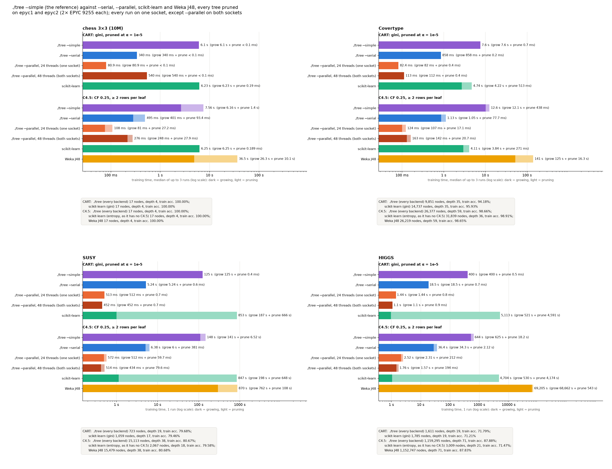

# Simple: ./tree's reference backend against --serial, --parallel, scikit-learn and Weka J48

**Status:** run on 2026-10-21 on epyc1, except HIGGS's J48 on epyc2, which has the same hardware.
- **chess 10M and Covertype:** run at commit e418f65, three runs per case.
- **SUSY and HIGGS:** run at commit 85ea702, one run per case, one SLURM job per tool and protocol (`simple-epyc-<data>-<tool>-<protocol>`).
- **--parallel on both sockets:** one run per case on all four datasets, at commit 8e9bac1.
- **HIGGS's Weka J48:** one run on epyc2 at commit 85ea702, like the rest of HIGGS (job 54), finished 2026-10-22 after 19.2 hours.

This is a quick general benchmark, so one run per case is enough for the big datasets and the dual-socket bars. Every tree is pruned, with no depth limit. The first version of this benchmark (chess 1M, epyc1 and dell1, scikit-learn unpruned) is in the git history (d4d4c1d).



## What runs

| Bar | Command | Threads | CPUs and memory |
|---|---|--:|---|
| ./tree --simple | `tree_cpu --simple --cart --alpha 1e-05` / `--simple --c45` | 1 | one socket |
| ./tree --serial | `tree_cpu --serial ...` | 1 | one socket |
| ./tree --parallel, one socket | `tree_cpu --parallel --threads 24 ...` | 24 | one socket |
| ./tree --parallel, both sockets | `tree_cpu --parallel --threads 48 ...` | 48 | the whole node |
| scikit-learn 1.9.1 | `DecisionTreeClassifier(ccp_alpha=1e-5)`: gini for CART, `criterion="entropy"` for C4.5 | 1 | one socket |
| Weka J48 3.8.7 | `-C 0.25 -M 2` (its defaults), C4.5 only | 1 | one socket |

- **Pruning:** every tool prunes.
  - ./tree prunes CART by cost-complexity at α = 1e-5, and C4.5 the way C4.5 does: collapse, CF 0.25 and subtree raising.
  - scikit-learn has only cost-complexity pruning (`ccp_alpha`), so it prunes both of its trees at the same α. It has no C4.5; its entropy tree is the nearest stand-in.
  - Weka has no CART in its core. SimpleCart is a separate package that prunes by cross-validation, so CART has no Weka bar.
- **α is not the same measure:**
  - ./tree's cost-complexity measure is Breiman's: R(T) is the misclassified fraction of the training rows ([cart_pruning.h](../../../src/algo/cart_pruning.h)).
  - scikit-learn's R(T) is the impurity weighted by row share (gini or entropy).
  - So the same α = 1e-5 gives different trees. scikit-learn prunes less: its CART tree is bigger on every dataset that is not separable (Covertype 14,737 nodes against 9,851, SUSY 1,059 against 723, HIGGS 1,785 against 1,611).
- **One socket:** every job owned its node (`--exclusive`).
  - Every run except the dual-socket bar was pinned to one socket (24 CPUs), with the memory bound to its NUMA node (job.sh `SOCKET=auto`). The one-thread runs use that socket's first CPU.
  - The dual-socket jobs (`simple-epyc-<data>-dual-<protocol>`) use all 48 CPUs and both NUMA nodes, with no pinning.
- **epyc1 and epyc2:** HIGGS's J48 job ran on epyc2 to finish sooner. epyc2 has the same hardware as epyc1 (2× EPYC 9255, governor performance). First, five short SUSY cases (one run each, `submit.sh -w epyc2`) were rerun on epyc2 to check this. They grew the same trees (same SHA-256), with the same times within 1%:

  | SUSY, one run | epyc1 | epyc2 |
  |---|--:|--:|
  | CART --simple | 125.4 s | 125.6 s |
  | CART --serial | 5.245 s | 5.245 s |
  | C4.5 --serial | 6.379 s | 6.437 s |
  | CART --parallel | 0.513 s | 0.515 s |
  | C4.5 --parallel | 0.572 s | 0.590 s |
- **Time:** the training time (not reading the data): the median of 3 runs (chess, Covertype) or a single run (SUSY, HIGGS, every dual-socket bar). Each bar is split into growing (dark) and pruning (light):
  - ./tree: its `prune` phase is the pruning part. For C4.5 this also includes --simple's sort of each feature's distinct values; --serial gets those from its presort, timed as growing ([paper/simple-vs-serial.md](../../../paper/simple-vs-serial.md), risk F).
  - scikit-learn: [sklearn_fit.py](../../adapters/sklearn_fit.py) fits with `ccp_alpha=0` (growing), then calls `_prune_tree()` at α (pruning). Those are the two steps `fit` takes.
  - Weka J48: [J48Fit](../../adapters/J48Fit.java) times `buildTree` (growing) apart from `collapse` + `prune` + `cleanup` (pruning). Its `check=1` mode confirmed that this grows the same tree as `J48.buildClassifier`.
  - The managed runtimes get one untimed warm-up fit on 50,000 rows first.
- **Single-threaded pruning:** --simple and --serial get no thread pool (`buildPool = nullptr` in trainer.cpp), so they prune on one thread too.

## Same trees

`run.py --hash-trees` records the SHA-256 of every ./tree tree (`--dump`). For each dataset and protocol, every ./tree run (--simple, --serial, --parallel on one socket and on both) produced the same tree:

| Dataset | Protocol | Tree SHA-256 (first 16) | Nodes | Depth | Train accuracy |
|---|---|---|--:|--:|--:|
| chess_10m | CART | a537d8753d217de7 | 17 | 4 | 100.00% |
| chess_10m | C4.5 | a7a65727f69d848a | 17 | 4 | 100.00% |
| covertype | CART | d18c31438ee3de2b | 9,851 | 35 | 94.18% |
| covertype | C4.5 | bf01ecc0f4651b88 | 26,377 | 59 | 98.66% |
| susy | CART | 94d1983c618f53cd | 723 | 19 | 79.68% |
| susy | C4.5 | 8afe20ed2579def1 | 15,113 | 38 | 80.67% |
| higgs | CART | 9b25f5a0daecce33 | 1,611 | 19 | 71.79% |
| higgs | C4.5 | 8f7df2d270ecfbae | 1,159,295 | 71 | 87.88% |

The other tools:

| Dataset | scikit-learn, gini | scikit-learn, entropy | Weka J48 |
|---|--:|--:|--:|
| chess_10m | 17 nodes, 100% | 17 nodes, 100% | 17 nodes, 100% |
| covertype | 14,737 nodes, 95.93% | 31,839 nodes, 98.91% | 26,219 nodes, 98.65% |
| susy | 1,059 nodes, 79.46% | 2,067 nodes, 79.58% | 15,479 nodes, 80.68% |
| higgs | 1,785 nodes, 71.21% | 3,009 nodes, 71.47% | 1,152,747 nodes, 87.83% |

- **Weka J48** grows nearly the same trees as ./tree's C4.5 (Covertype: 26,219 nodes against 26,377, both of depth 59; SUSY: 15,479 against 15,113; HIGGS: 1,152,747 against 1,159,295, both of depth 71). ./tree follows C4.5 Release 8, which was verified node for node earlier (2026-10-13), and J48 differs from R8 in small details.
- **scikit-learn's entropy tree is not C4.5:** on HIGGS it keeps 3,009 nodes, while C4.5's pessimistic pruning keeps 1,159,295.

## Results (median training time; pruning part in brackets)

| Dataset | Protocol | --simple | --serial | --parallel, 24 (one socket) | --parallel, 48 (both) | scikit-learn | Weka J48 |
|---|---|--:|--:|--:|--:|--:|--:|
| chess_10m | CART | 6.10 s | 340 ms | 80.9 ms | 540 ms | 6.23 s (0.2 ms) | – |
| chess_10m | C4.5 | 7.56 s (1.40 s) | 495 ms (93 ms) | 108 ms (27 ms) | 276 ms (28 ms) | 6.25 s (0.2 ms) | 36.5 s (10.1 s) |
| covertype | CART | 7.60 s (0.7 ms) | 858 ms (0.2 ms) | 82.4 ms (0.4 ms) | 113 ms (0.4 ms) | 4.74 s (513 ms) | – |
| covertype | C4.5 | 12.6 s (438 ms) | 1.13 s (78 ms) | 124 ms (17 ms) | 163 ms (21 ms) | 4.11 s (271 ms) | 141 s (16.3 s) |
| susy | CART | 125 s (0.4 ms) | 5.24 s (0.6 ms) | 513 ms (0.7 ms) | 452 ms (0.7 ms) | 853 s (666 s) | – |
| susy | C4.5 | 148 s (6.52 s) | 6.38 s (381 ms) | 572 ms (60 ms) | 514 ms (80 ms) | 847 s (648 s) | 870 s (108 s) |
| higgs | CART | 400 s (0.5 ms) | 18.5 s (0.7 ms) | 1.44 s (0.8 ms) | 1.10 s (0.9 ms) | 5,113 s (4,591 s) | – |
| higgs | C4.5 | 644 s (18.2 s) | 36.4 s (2.12 s) | 2.52 s (212 ms) | 1.76 s (194 ms) | 4,704 s (4,174 s) | 69,205 s (543 s) |

- **--simple against --serial:** --serial is faster by:
  - 15–18× on chess 10M and 9–11× on Covertype;
  - 23–24× on SUSY and 18–22× on HIGGS.

  --simple sorts each node's rows again for every feature; --serial sorts once and keeps the order while it partitions (paper/simple-vs-serial.md lists all 30 differences).
- **--parallel on one socket against --serial:** 4.2–4.6× faster on chess, which has only two features to share among 24 threads. 9–10× faster on Covertype, 10–11× on SUSY and 13–14× on HIGGS.
- **Both sockets against one:** the second socket helps only on the big datasets.
  - HIGGS: 1.3–1.4× faster. SUSY: 1.1× faster.
  - Covertype: 1.3× slower. chess 10M: 2.6–6.7× slower.
  - With small inputs, the threads on the other socket mostly cost cross-socket memory traffic and synchronisation. Earlier full-node chess 10M runs (cluster-chess) also spread from 0.09 to 0.59 s, so the single 540 ms run may be one of the slow ones.
- **--simple against the libraries:**
  - About as fast as scikit-learn on chess, and 1.6–3.1× slower on Covertype.
  - 5.7–6.8× faster than scikit-learn on SUSY and 7.3–13× faster on HIGGS. scikit-learn's growing alone is in the same range as --simple's (SUSY 187–198 s against 125–141 s; HIGGS 521–530 s against 400–625 s). Its pruning makes the difference (below).
  - Faster than J48 by 4.8× on chess, 11× on Covertype, 5.9× on SUSY and 107× on HIGGS.
  - J48 on HIGGS: 68,662 s growing and 543 s pruning, with a peak RSS of 45 GiB. Its growing time is 90× SUSY's, for 2.3× the rows and 76× the nodes. A likely cause (not profiled): after choosing a numeric split, J48's `C45ModelSelection` calls `setSplitPoint` on the whole training set, to move the threshold to a value that occurs in the data. That is one scan of all 10.5M rows for each of the 576k internal nodes.
  - --serial is 13–18× faster than scikit-learn on chess, 3.6–5.5× on Covertype, about 130× on SUSY and 130–280× on HIGGS. It is 74–136× faster than J48 on the first three datasets and 1,900× on HIGGS.
- **Pruning:**
  - CART at a fixed α takes ./tree under 1 ms on every dataset: one bottom-up pass over the tree.
  - scikit-learn's cost-complexity pruning repeats a scan of the whole fully grown tree for every branch it removes, so its time grows with the square of that tree's size. It takes 0.2 ms on chess, 0.3–0.5 s on Covertype, 11 minutes on SUSY and 70–77 minutes on HIGGS.
  - C4.5's pruning:
    - --simple: 1.40 s on chess, 438 ms on Covertype, 6.5 s on SUSY and 18 s on HIGGS. Part of that is the distinct-value sort counted there.
    - --serial: 93 ms, 78 ms, 381 ms and 2.1 s.
    - J48: 10 s, 16 s, 108 s and 543 s.

## Is scikit-learn's pruning time real?

Yes. [sklearn_prune_check.py](../../sklearn_prune_check.py) ran on SUSY subsets, one thread on epyc1 (2026-10-21):

| Rows | Full tree | Plain `fit(ccp_alpha)` | Grow + `_prune_tree` | Same tree? | One-pass bottom-up |
|--:|--:|--:|--:|---|--:|
| 250k | 66,871 nodes | 8.2 s | 6.9 + 1.2 = 8.2 s | yes | 10,540 leaves (sklearn 10,542), < 0.1 s |
| 500k | 133,453 | 22.4 s | 15.1 + 7.4 = 22.5 s | yes | 1,736 leaves (1,738), < 0.1 s |
| 1M | 266,545 | 66.1 s | 33.5 + 32.7 = 66.2 s | yes | 730 leaves (730), 0.1 s |
| 2M | 531,917 | 206.5 s | 72.8 + 133.1 = 206.0 s | yes | 588 leaves (588), 0.2 s |

- **The split is valid:** `fit` itself calls `_prune_tree()` last (sklearn/tree/_classes.py), and the split gives the same tree in the same total time as a plain `fit`.
- **The pruning is quadratic:** each doubling of the full tree makes pruning 4–6× slower, while growing only doubles.
  - Extending that to all 4.5M rows (a full tree of about 1.2M nodes) gives about 670 s, which matches the 650–666 s measured above.
  - The cause is in `_cost_complexity_prune` (sklearn/tree/_tree.pyx). It removes the weakest branch one at a time, and before each removal it scans every node of the full tree for the smallest effective α.
- **It need not be slow:** pruning the same full tree to the same α in one bottom-up pass, as ./tree does, is a Python loop of 0.2 s. It gives the same tree, apart from 2 leaves on the two smallest subsets, most likely ties.

## Reproduce

```bash
# on mordor3, after build.sh and prepare.sh covertype (bench/cluster/README.md)
for d in chess_10m covertype; do
  bench/cluster/submit.sh -m 3 -d $d -o cluster-simple simple-epyc-$d
done
# SUSY and HIGGS: one run, one job per tool and protocol (J48 has no CART)
for d in susy higgs; do
  bench/cluster/submit.sh -m 1 -d $d -o cluster-simple $(for t in parallel serial sklearn simple; do
    echo simple-epyc-$d-$t-cart simple-epyc-$d-$t-c45; done) simple-epyc-$d-j48-c45
done
# --parallel on both sockets, every dataset
for d in chess_10m covertype susy higgs; do
  bench/cluster/submit.sh -m 1 -d $d -o cluster-simple simple-epyc-$d-dual-cart simple-epyc-$d-dual-c45
done
bench/.venv/bin/python bench/simple_chart.py bench/results/cluster-simple
```

- `simple-epyc-<data>` runs use impls `tree,tree_simple,sklearn,j48` with threads `1,all`.
- `simple-epyc-<data>-<tool>-<protocol>` runs one of them, with a time limit that fits the tool. `-w epyc2` sends jobs to epyc2.
- Every simple job passes `RUN_EXTRA=--hash-trees` to job.sh, and all but the `dual` ones pass `SOCKET=auto`.
- `simple_chart.py` refuses to draw if the ./tree backends' tree hashes differ.
