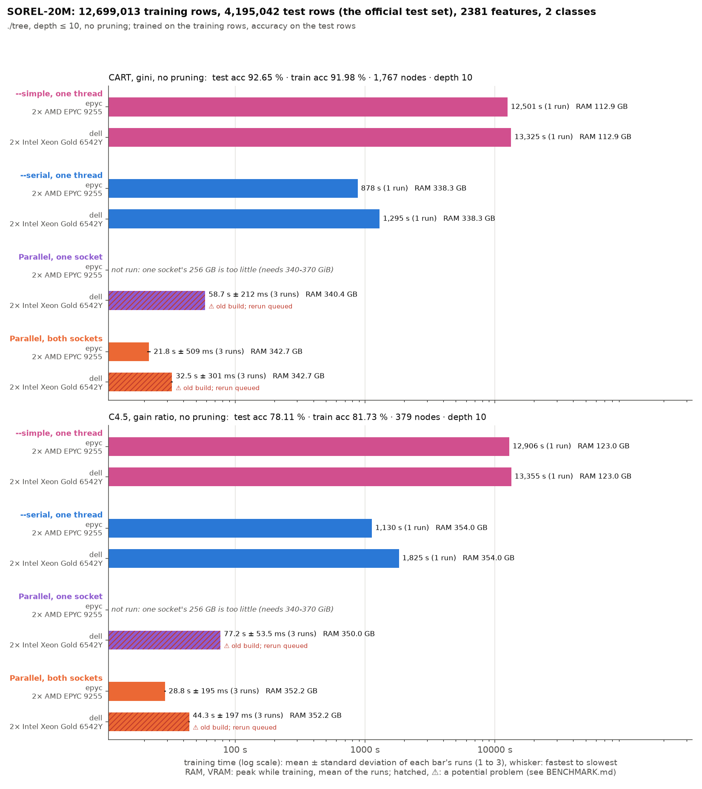
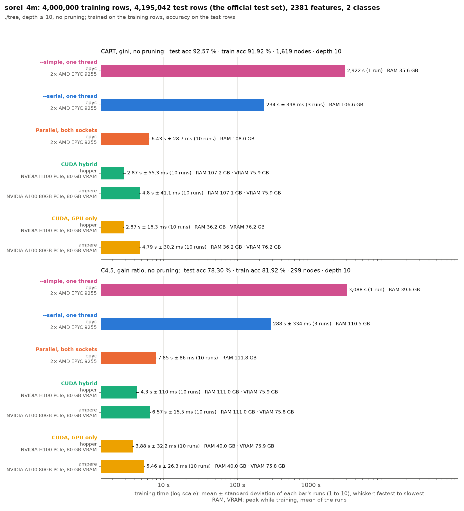

# SOREL-20M (malware, 2381 features): training set and test set

./tree only, trained on the training rows and scored on the test rows
([bench/cluster/README.md](../../cluster/README.md#test-set-benchmarks)).

- **Training rows:** `sorel`: SOREL-20M's training set, 12,699,013 rows of EMBER v2 features (2381, float32), label malware/benign, on the CPU nodes only. The CSV is 136 GB; as float32 about 120 GB, so it does not fit an 80 GB GPU. `sorel_4m`: the first 4,000,000 training rows (9.52G values, about `ecbdl_15m`'s 9.47G), the most that fits an 80 GB GPU with room to spare, on the GPUs and epyc.
- **Test rows:** SOREL-20M's test set, 4,195,042 rows, for both.
- **Protocols:** depth ≤ 10, CART (gini) and C4.5 (gain ratio), both without pruning.
- **Runs:** `sorel` on epyc (2× EPYC 9255, 512 GB) and dell1 (2× Xeon Gold 6542Y, 1 TB): parallel on both sockets, --serial and --simple (one thread); parallel on one socket on dell1 only, since one epyc socket has 256 GB and the runs need 338–354 GiB. `sorel_4m`: CUDA hybrid and GPU only on ampere (A100 80 GB) and hopper (H100), and on epyc parallel on both sockets, --serial and --simple. Hopper ran on 2026-11-06 (jobs 19 and 22), on GPU 2 with NUMA node 1 and its 16 CPUs (16–31), which `job.sh` picked as the node with the most free memory. Runs per case: 10 when a run takes about 2 minutes or less, 3 under about 10 minutes, longer ones once, the parallel `sorel` runs 3 (the chart and the table give the count).
- **Builds:** `sorel`: ./tree at ec77727 (with the CPU presort of 4fb419c and `-falign-functions=64 -falign-loops=32`), 2026-10-29/30, except --simple: 32cf657 on 2026-11-02 (its `src/` is da1f100's, the loader that drops the CSV from the page cache; why it was rerun: below). `sorel_4m`: 4ece22f (`src/` = da1f100), built 2026-11-02, the same build on ampere, epyc and hopper (hopper's runs came on 2026-11-06). It predates 50d29cd, which made SOREL 4M C4.5 hybrid on the A100 6.38 → 5.33 s (job 61). Why one build, and the batches that ran it: [bench/cluster/README.md](../../cluster/README.md#reruns-of-2026-102930). Older runs are in git.
- **Measured:** ./tree's training time, peak RAM while training, peak VRAM; the tree's test and training accuracy, nodes and depth.
- **Chart:** `chart-sorel.png` (full) and `chart-sorel_4m.png`, `bench/testset_chart.py` (log scale).

## Results

Run on 2026-10-29/30 (`sorel` parallel and --serial) and 2026-11-02 (`sorel` --simple, `sorel_4m`). Parallel `sorel` runs: 3 each, with about 30 minutes for the whole process (reading the 136 GB CSV); --serial and --simple once. The tables give ./tree's training time (`bench/testset_chart.py --table`), RAM the mean of CART and C4.5. Accuracies, nodes and depth are the same in every run of a training set.

- **Same tree everywhere:** on each training set, every run grew the same tree (`sorel`: the same `tree_sha256` in every run; `sorel_4m`: the same nodes, depth and accuracies, the hash recorded for --simple only).
- **Speed:** CART takes 21.8 s on epyc and 32.5 s on dell, C4.5 28.8 s and 44.3 s (dell 1.5× epyc). One socket on dell takes 1.7–1.8× the two-socket time (58.7 s and 77.2 s).
- **Serial:** 878 s (CART) and 1,130 s (C4.5) on epyc, 39–40× the parallel run; 1,295 s and 1,825 s on dell, 40–41×.
- **Simple:** 12,501 s (CART) and 12,906 s (C4.5) on epyc, 13,325 s and 13,355 s on dell (about 3.5 h): epyc is 0.94–0.97× dell, as --simple is on the other datasets. --simple is 11–14× --serial on epyc, 7–10× on dell. RAM: 113 GiB (CART) and 123 GiB (C4.5), a third of the parallel runs'.
- **The first --simple runs were off:** on 2026-10-27/28 epyc took 14,124 s and 14,240 s, 1.1× dell (12,414 s and 12,712 s), the only case on any dataset where epyc was slower. Those runs started with 159–185 GB free on epyc's node 0 (normally ~260 GB): run.py's data check still held about 135 GiB of pyarrow memory in the harness, and the loader then kept the 136 GB CSV in the page cache as well, so part of the 121 GB of values most likely went to node 1, the other socket, while ./tree ran on CPU 0. --simple sorts row indices by `value(row, feature)`, a chain of random reads that is bound by memory latency, so remote memory hurts it most. With the check in a child process (8bdf641) and the loader dropping the CSV from the page cache (da1f100), the reruns started with 261 GB free on node 0 and epyc took 11% (CART) and 9% (C4.5) less. Dell's reruns took 5–7% longer than its first runs (one run each, so not conclusive). [docs/PERFORMANCE.md](../../../docs/PERFORMANCE.md#november-2026-sorels---simple-and-numa) has more.
- **Accuracy:** CART 92.7% on the test set, C4.5 78.1%.
- **Memory:** 338–343 GiB for CART, 350–354 GiB for C4.5, about 12 bytes for each of the 30 billion values. C4.5 peaked at 369–371 GiB in the runs before the 2026-10-28 build, whose C4.5 distinct values are counted, then written in place.
- **The harness once ran out of memory, not ./tree:** on 2026-10-28 C4.5 on epyc died at 361–362 GiB (two OOM kills in /proc/vmstat), because run.py's data check had read the 136 GB CSV with pyarrow in its own process and kept about 135 GiB. run.py now runs that check in a child process; free memory before each run equals that at the start of the job.
- **4M sample on the GPUs:** the A100 takes 4.8 s (CART, hybrid and GPU only alike), 1.3× faster than epyc's 6.43 s; C4.5 6.57 s hybrid and 5.46 s GPU only, 1.2× and 1.4× faster than epyc's 7.85 s. That is about the A100's ECBDL 15M time (5.0–5.1 s) for about the same number of values, while epyc is about as fast as on ECBDL 15M (6.32 s and 7.81 s). Peak VRAM 75.8–76.2 GiB (ECBDL 15M: 73.3), so 4M rows is about the limit. GPU only needs 36–40 GiB of RAM, against 107–112 GiB for hybrid and the parallel CPU runs. The H100 (hopper) takes 2.87 s for CART in both modes, 2.2× faster than epyc and 1.7× faster than the A100; C4.5 4.30 s hybrid and 3.88 s GPU only, 1.8× and 2.0× faster than epyc, 1.5× and 1.4× faster than the A100. As on the A100, GPU only beats hybrid on C4.5.
- **4M sample on the CPU:** --serial takes 234 s and 288 s, 36–37× the parallel run; --simple 2,922 s and 3,088 s, 11–12× --serial. The parallel run takes 3.4–3.7× less than on all 12.7M rows (3.2× the rows).

### sorel

| Protocol | test acc | train acc | nodes | depth |
|---|---|---|---|---|
| CART, no pruning | 92.65% | 91.98% | 1,767 | 10 |
| C4.5, no pruning | 78.11% | 81.73% | 379 | 10 |

| Run | runs | CART | C4.5 | RAM GiB (peak) |
|---|---|---|---|---|
| epyc, --simple, one thread | 1 | 12,501 s | 12,906 s | 118.0 |
| dell, --simple, one thread | 1 | 13,325 s | 13,355 s | 118.0 |
| epyc, --serial, one thread | 1 | 878 s | 1,130 s | 346.1 |
| dell, --serial, one thread | 1 | 1,295 s | 1,825 s | 346.1 |
| dell, parallel, one socket | 3 | 58.7 s ± 212 ms | 77.2 s ± 53.5 ms | 345.2 |
| epyc, parallel, both sockets | 3 | 21.8 s ± 509 ms | 28.8 s ± 195 ms | 347.5 |
| dell, parallel, both sockets | 3 | 32.5 s ± 301 ms | 44.3 s ± 197 ms | 347.5 |

### sorel_4m

| Protocol | test acc | train acc | nodes | depth |
|---|---|---|---|---|
| CART, no pruning | 92.57% | 91.92% | 1,619 | 10 |
| C4.5, no pruning | 78.30% | 81.92% | 299 | 10 |

| Run | runs | CART | C4.5 | RAM GiB (peak) | VRAM GiB (peak) |
|---|---|---|---|---|---|
| epyc, --simple, one thread | 1 | 2,922 s | 3,088 s | 37.6 | – |
| epyc, --serial, one thread | 3 | 234 s ± 398 ms | 288 s ± 334 ms | 108.5 | – |
| epyc, parallel, both sockets | 10 | 6.43 s ± 28.7 ms | 7.85 s ± 86 ms | 109.9 | – |
| hopper, CUDA hybrid | 10 | 2.87 s ± 55.3 ms | 4.3 s ± 110 ms | 109.1 | 75.9 |
| ampere, CUDA hybrid | 10 | 4.8 s ± 41.1 ms | 6.57 s ± 15.5 ms | 109.1 | 75.8 |
| hopper, CUDA, GPU only | 10 | 2.87 s ± 16.3 ms | 3.88 s ± 32.2 ms | 38.1 | 76.0 |
| ampere, CUDA, GPU only | 10 | 4.79 s ± 30.2 ms | 5.46 s ± 26.3 ms | 38.1 | 76.0 |
