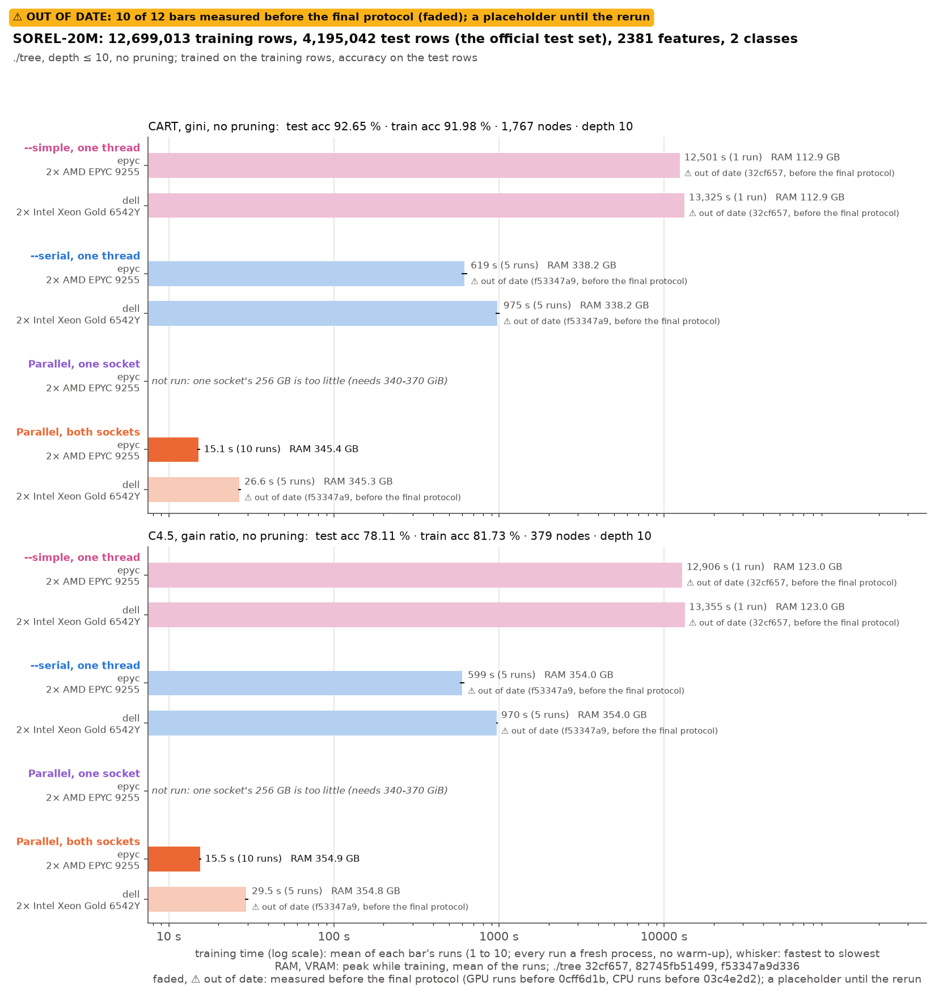
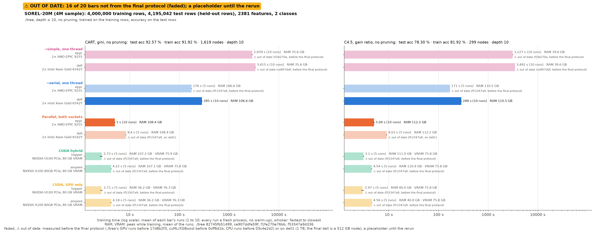

# SOREL-20M (malware, 2381 features): training set and test set

./tree only, trained on the training rows and scored on the test rows
([bench/cluster/README.md](../../cluster/README.md#test-set-benchmarks)).

- **Training rows:** `sorel`: SOREL-20M's training set, 12,699,013 rows of EMBER v2 features (2381, float32), label malware/benign, on the CPU nodes only. The CSV is 136 GB; as float32 about 120 GB, so it does not fit an 80 GB GPU. `sorel_4m`: the first 4,000,000 training rows (`./tree --rows`; 9.52G values, about `ecbdl_15m`'s 9.47G), the most that fits an 80 GB GPU with room to spare, on every node.
- **Test rows:** SOREL-20M's test set, 4,195,042 rows, for both.
- **Protocols:** depth ≤ 10, CART (gini) and C4.5 (gain ratio), both without pruning.
- **Runs:** CUDA `--hybrid` and `--gpu` (GPU only) on hopper (H100) and ampere (A100 80 GB), with every CPU of the node; on epyc (2× EPYC 9255) and dell (2× Xeon Gold 6542Y): `--multicore` on both sockets (48 threads), `--serial` and `--simple` (one thread). Runs per case: 5; `--simple` 10 on `sorel_4m`, once on `sorel` (about 3.5 hours a run).
- **Builds:** ./tree at f53347a9 (`src/` = d2957ff2: presort of big columns in cache, GPU tiles without a cut skipped, CART bound per node), one build for every node, run on 2026-11-15/16 by `bench/cluster/final.sh -m 5` ([bench/cluster/README.md](../../cluster/README.md#the-final-rerun)): `--multicore` and CUDA on epyc1, dell1, hopper and ampere, `--serial` spread over epyc1/epyc2 and dell1/dell2/dell3 (the same hardware). `--simple` was not rerun, its code has not changed: its runs are from 2026-11-10/11 (`sorel_4m`, f1fe270e on epyc and ce907ddf on dell) and 2026-11-02 (`sorel`, 32cf657) (`machine.json` says which). The runs before (f1fe270e, 10 runs per case, 2026-11-09/12) are in git at 1e655067.
- **Measured:** ./tree's training time (presort, build; not reading the CSV), peak RAM while training, peak VRAM; the tree's test and training accuracy, nodes, depth and SHA-256.
- **Chart:** `chart-sorel.png` (full) and `chart-sorel_4m.png`, `bench/testset_chart.py` (log scale).

## Results

Every run of a case grew the same tree (the same `tree_sha256`). The tables give the mean ± standard deviation of ./tree's training time (`bench/testset_chart.py --table`); "runs" is the number of runs of the case, also on the chart.

- **4M sample:** the H100 takes 2.71–3.10 s, 1.6–1.8× faster than epyc's `--multicore` (4.95 and 5.00 s); the A100 4.18–4.56 s, 1.1–1.2× faster; dell 8.40 and 9.03 s, 1.7–1.8× epyc. GPU only needs 38 GB of RAM, hybrid and `--multicore` 109–110 GB.
- **Full set (CPU only):** epyc takes 15.3 s (CART) and 15.5 s (C4.5), dell 26.6 s and 29.5 s (1.7–1.9× epyc), with 350 GB of RAM, about 12 bytes for each of the 30 billion values.
- **Serial:** 619 s (CART) and 599 s (C4.5) on epyc, 39–41× `--multicore`; 975 s and 970 s on dell, 33–37×.
- **Simple:** 12,501 s (CART) and 12,906 s (C4.5) on epyc, 13,325 s and 13,355 s on dell, 20–22× `--serial` on epyc and 14× on dell, with 118 GB of RAM. These are the reruns of 2026-11-02, with the data check in a child process (8bdf641) and the loader dropping the CSV from the page cache (da1f100): the first runs had part of the values on the other socket and were 9–11% slower on epyc ([docs/PERFORMANCE.md](../../../docs/PERFORMANCE.md#november-2026-sorels---simple-and-numa)).
- **Against the runs before (f1fe270e):** `--multicore` 23–43% faster on epyc and 18–36% on dell, `--serial` 23–45% on epyc and 16–46% on dell, the GPUs 10–16%.
- **Accuracy:** CART 92.7% on the test set, C4.5 78.1% (4M sample: 92.6% and 78.3%).
- **The 4M tree's hash changed, not the tree:** `sorel_4m` is now `sorel`'s first 4M rows read with `./tree --rows` instead of a copied CSV (f2a4f921). The new runs hash b414ee6d (CART) and 089479c6 (C4.5), `--simple` (run on the copy) 4bf06cac and a4461fb4, with the same rows, nodes, depth and accuracies; the full set's hashes are the same as before.

### sorel

| Protocol | test acc | train acc | nodes | depth |
|---|---|---|---|---|
| CART, no pruning | 92.65% | 91.98% | 1,767 | 10 |
| C4.5, no pruning | 78.11% | 81.73% | 379 | 10 |

| Run | runs | CART | C4.5 | RAM GB (peak) | VRAM GB (peak) |
|---|---|---|---|---|---|
| epyc, --simple, one thread | 1 | 12,501 s | 12,906 s | 118.0 | – |
| dell, --simple, one thread | 1 | 13,325 s | 13,355 s | 118.0 | – |
| epyc, --serial, one thread | 5 | 619 s ± 14.3 s | 599 s ± 13.4 s | 346.1 | – |
| dell, --serial, one thread | 5 | 975 s ± 16.4 s | 970 s ± 3.41 s | 346.1 | – |
| epyc, parallel, both sockets | 5 | 15.3 s ± 172 ms | 15.5 s ± 21.9 ms | 350.2 | – |
| dell, parallel, both sockets | 5 | 26.6 s ± 253 ms | 29.5 s ± 307 ms | 350.1 | – |

### sorel_4m

| Protocol | test acc | train acc | nodes | depth |
|---|---|---|---|---|
| CART, no pruning | 92.57% | 91.92% | 1,619 | 10 |
| C4.5, no pruning | 78.30% | 81.92% | 299 | 10 |

| Run | runs | CART | C4.5 | RAM GB (peak) | VRAM GB (peak) |
|---|---|---|---|---|---|
| epyc, --simple, one thread | 10 | 2,939 s ± 9.59 s | 3,127 s ± 16 s | 37.6 | – |
| dell, --simple, one thread | 10 | 3,415 s ± 3.26 s | 3,492 s ± 2.05 s | 37.6 | – |
| epyc, --serial, one thread | 5 | 176 s ± 154 ms | 171 s ± 403 ms | 108.5 | – |
| dell, --serial, one thread | 5 | 291 s ± 2.37 s | 294 s ± 1.26 s | 108.5 | – |
| epyc, parallel, both sockets | 5 | 4.95 s ± 45.5 ms | 5 s ± 46.9 ms | 110.3 | – |
| dell, parallel, both sockets | 5 | 8.4 s ± 53.8 ms | 9.03 s ± 143 ms | 110.3 | – |
| hopper, CUDA hybrid | 5 | 2.73 s ± 114 ms | 3.1 s ± 33.6 ms | 109.1 | 75.9 |
| ampere, CUDA hybrid | 5 | 4.22 s ± 20.3 ms | 4.54 s ± 60.2 ms | 109.0 | 75.8 |
| hopper, CUDA, GPU only | 5 | 2.71 s ± 120 ms | 2.97 s ± 113 ms | 38.1 | 76.1 |
| ampere, CUDA, GPU only | 5 | 4.18 s ± 64.3 ms | 4.56 s ± 21.5 ms | 38.1 | 76.1 |
