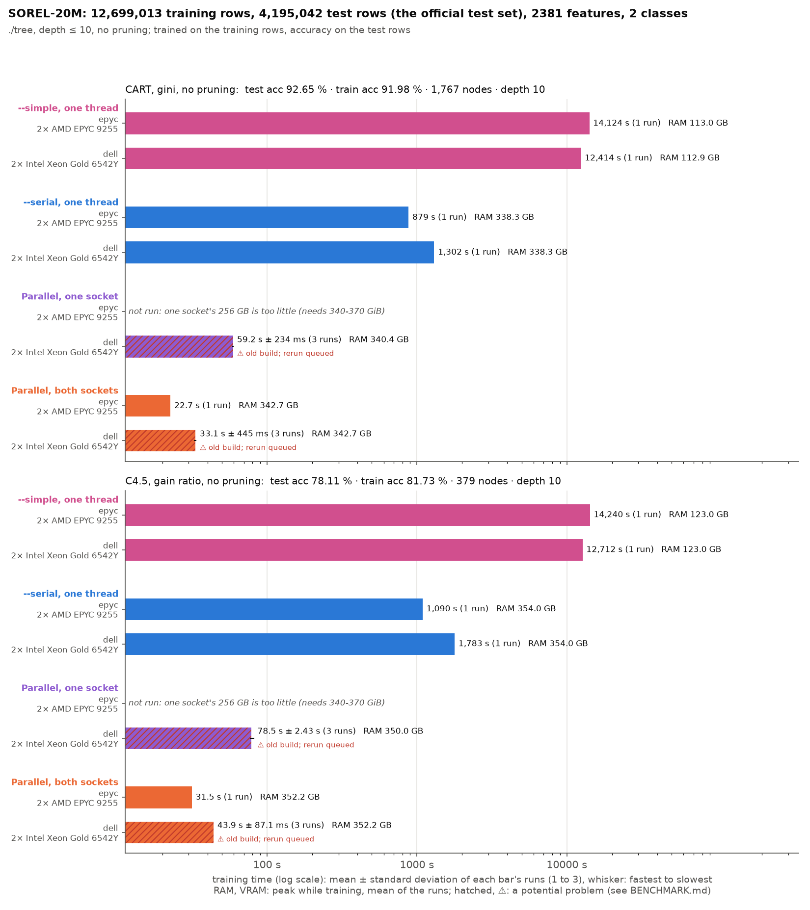

# SOREL-20M (malware, 2381 features): training set and test set

./tree only, trained on the training rows and scored on the test rows
([bench/cluster/README.md](../../cluster/README.md#test-set-benchmarks)).

- **Training rows:** SOREL-20M's training set, 12,699,013 rows of EMBER v2 features (2381, float32), label malware/benign. The CSV is 136 GB; as float32 about 120 GB, so it does not fit an 80 GB GPU: CPU runs only.
- **Test rows:** SOREL-20M's test set, 4,195,042 rows.
- **Protocols:** depth ≤ 10, CART (gini) and C4.5 (gain ratio), both without pruning.
- **Runs:** on epyc1/epyc2 (512 GB) and dell1 (1 TB): parallel on both sockets (three runs), --serial (one run), --simple (one run); parallel on one socket on dell1 only, since one epyc socket has 256 GB and the runs need 340–370 GiB.
- **Measured:** ./tree's training time, peak RAM while training, peak VRAM; the tree's test and training accuracy, nodes and depth.
- **Chart:** `chart.png`, `bench/testset_chart.py` (log scale).
- **Reruns queued (2026-10-28, jobs 381–545, `bench/cluster/submit-variants-2026-10-28.sh` and `submit-topup-2026-10-28.sh`):** the missing variants, and more runs: a case whose run takes about 2 minutes or less (the whole process) gets 10 runs, one under about 10 minutes 5, a longer one keeps what it has. The runs here count; only the missing ones run (into `cluster-sorel-new/` and `-top/` on mordor3), and `bench/merge_runs.py` adds them to the run folders here when done. Parallel on epyc, 10 runs in all, recording the page-reclaim counters (`vmstat_*`) to explain C4.5's presort taking 11 s in one run and 34 s in two; --simple on epyc again, now with all the memory free: it is slower than on dell (14,124 s against 12,414 s for CART), and its first runs had only 152–207 GiB free beside the memory held by the data check (below), so part of its data likely went to the other socket; and one run of each GPU backend on hopper and ampere, to record how the 120 GB float32 data fails on an 80 GB GPU. No one-socket run: it does not fit in one socket's 250 GiB. The chart draws mean ± standard deviation and the number of runs, and marks the folders still waiting as "queued" or "still running".
- **Spin stall, fixed 2026-10-28 (rerun queued, jobs 550–570, `bench/cluster/submit-spinfix-2026-10-28.sh`):** the parallel backend partitions a big node (≥ 1M rows, few columns to move) in blocks taken in order by all threads, each block waiting for the one before it. It waited by spinning (`_mm_pause`) without end: when the thread of the block before was descheduled, the other threads spun and kept it off a CPU, so some runs took 2–8× as long (epyc chess_10m: user time 5 s instead of 2 s, the same system time; 11 of 80 runs > 2× the median). It now spins 2,048 pauses, then sleeps (`atomic::wait`, woken by the block before). On epyc2, 40 runs each of chess_10m (48 threads): CART 0.155 ± 0.131 s → 0.087 ± 0.005 s, C4.5 0.186 ± 0.163 s → 0.095 ± 0.005 s, no run above 2× the median. Only the parallel backend has those blocks (CUDA hybrid gives the CPU nodes under 4,096 rows; --serial and --simple have no pool), so only the parallel epyc runs (both sockets, one socket) start over, with 10 runs a case (full ECBDL 5), into `cluster-<dataset>-fix/`, replacing the old folders when done. The dell runs of ./tree_cpu run again too (below); until the reruns are in, the bars of old builds are marked (hatched, ⚠, from `problems.json`), as are runs more than twice the mean of the other runs.
- **C4.5 presort spread, fixed 2026-10-28 (job 571):** C4.5's presort took 11 s in one epyc run and 34 s in two (CART: 6 s every time; dell steady at 15 s), with about 25 s more system time in the slow runs. The extra step is C4.5's list of every feature's distinct values (its thresholds are training values): it grew 2,381 × 13 vectors on all threads at once, then copied them one after another on one thread. All those allocations (page faults, with the kernel's NUMA balancing moving the pages of the 242 GB of sorted columns between the sockets) made it vary. It now counts the values first and writes them in place on the pool, with no allocation there. On epyc1, 4 interleaved runs each (48 threads, same tree in all 8): presort 16.8 / 9.4 / 9.4 / 16.6 s before, 7.9 / 10.1 / 10.1 / 10.2 s after, with 2.5× fewer page faults (about 260,000 against 640,000–730,000). The parallel epyc rerun (job 561) uses the new build.
- **One build for every epyc ./tree_cpu run (2026-10-28, `bench/cluster/submit-final-2026-10-28.sh`):** after the spin fix, C4.5's list of distinct values (its thresholds are training values) was made allocation-free: counted, then written in place on the pool, and in one pass with --serial (SOREL's C4.5 presort on epyc varied 11–34 s; see cluster-sorel). Same trees as before in every check (SOREL, HIGGS, airline, ECBDL 15M, serial and parallel). So that every epyc run of ./tree_cpu is of that one build, the parallel runs started before it (jobs 550–556) run again, and --serial runs again for every dataset (10 runs a case of about 2 minutes or less, 5 under about 10 minutes, longer ones once), into `cluster-<dataset>-fix/`, replacing the old folders. The long runs (full ECBDL and SOREL parallel, every --serial, then --simple) run one after another on epyc2, the short parallel ones on epyc1. CUDA hybrid, GPU only and --simple do not use that code and are not rerun. Every dell run of ./tree_cpu (parallel on both sockets, on one socket, dell2's 512 GB, --serial) runs again on the same build too (`bench/cluster/submit-dell-chess-2026-10-28.sh`, jobs 592–618: parallel on dell1, then --serial there; dell2 only its 512 GB runs), the same runs as before, replacing the old folders; --simple on dell stays.
- **Every run again on one build each, in batches (2026-10-28 evening, `bench/cluster/submit-batches-2026-10-28.sh`, jobs 636–645):** the pending jobs above were cancelled and replaced by a few batch jobs (`bench/cluster/batch.sh`: one SLURM job per node and group, its runs one after another). No GPU runs: SOREL does not fit in 80 GB of VRAM. On the CPU, dell and epyc for every backend (--simple, --serial, parallel on one socket, on both), on the final ./tree_cpu; the runs already done on it are kept, as are --simple's (that code did not change); epyc on one socket cannot run SOREL (256 GB a socket, it needs 340–370 GiB). Runs per case: about 2 minutes or less 10, under about 10 minutes 3, longer once; long runs on epyc2 (epyc1 stays free for the short ones), every dell run on dell1, short batch first. Test accuracy is now predicted once per distinct tree (`bench/run.py`), not once per run. The chart groups the bars by backend, the nodes under each; it reads `cluster-sorel-fix/` too: a rerun done replaces the old bar, one pending marks it ("old build; rerun queued") or shows as "queued".

## Results

Run at 8187eb9 (`-dirty`: the uncommitted bench/ changes adding the dataset and the run.py fix below; ./tree's code is 8187eb9): --simple on 2026-10-27/28, the parallel, one-socket and --serial runs again on 2026-10-28 after the fix. The tables give means of ./tree's training time. Accuracies, nodes and depth are the same in every run. **Still running** on 2026-10-28: both --serial runs on dell (marked so in the chart and the table).

- **Same tree everywhere:** every run grew the same tree, C4.5 on epyc included.
- **C4.5 on epyc was killed by the harness's memory, not ./tree's:** it peaks at 370 GiB on dell1. On epyc2 (512 GB) the process died at 361–362 GiB with no output, both parallel and --serial; the kernel's OOM-kill counter on epyc2 (`oom_kill 2` in /proc/vmstat) confirms two OOM kills. The cause: run.py's data check read the 136 GB CSV with pyarrow in its own process and kept about 135 GiB after it (free memory before every run: 362 GiB, against 497 GiB at the start of the job; on dell1 about 185 GiB was held the same way). run.py now runs the check in a child process, and free memory before each run equals that at the start of the job (epyc: 250 GiB per NUMA node). The held memory had also moved part of the --serial runs' data to the other socket's memory, so every parallel, one-socket and --serial run was redone with the fix; the --simple runs (113–123 GiB) fit beside the held memory and were kept. With the fix C4.5 runs on epyc (371 GiB).
- **Speed:** CART takes 22.9 s on epyc, 32.9 s on dell. C4.5 takes 46.8 s on dell and 49.2 s on epyc, where it is noisy: 33.7 s in the first run, 56.8–56.9 s in the other two (same tree, same memory). One socket on dell takes 1.7–1.8× the two-socket time (59.3 s and 80.4 s).
- **Serial:** 895 s (CART) and 1,167 s (C4.5) on epyc, 39× and 24× the parallel run, with 338 and 369 GiB of RAM. dell's is still running.
- **Simple:** 12,414 s (CART) and 12,712 s (C4.5) on dell, 14,124 s and 14,240 s on epyc (about 4 h): epyc is 1.1× slower here, unlike every other run. CART on epyc is 16× --serial. RAM: 113 GiB (CART) and 123 GiB (C4.5), a third of the parallel runs'.
- **Accuracy:** CART 92.7% on the test set, C4.5 78.1%.
- **Memory:** 338–343 GiB for CART, 369–371 GiB for C4.5, about 12 bytes for each of the 30 billion values.

| Protocol | test acc | train acc | nodes | depth |
|---|---|---|---|---|
| CART, no pruning | 92.65% | 91.98% | 1,767 | 10 |
| C4.5, no pruning | 78.11% | 81.73% | 379 | 10 |

| Run | CART | C4.5 | RAM GiB (peak) |
|---|---|---|---|
| epyc, parallel, both sockets | 22.9 s | 49.2 s | 342.7–371.1 |
| dell, parallel, both sockets | 32.9 s | 46.8 s | 342.7–369.8 |
| dell, parallel, one socket | 59.3 s | 80.4 s | 340.4–369.4 |
| epyc, --serial | 895 s | 1,167 s | 338.3–369.3 |
| dell, --serial | still running | still running | – |
| epyc, --simple | 14,124 s | 14,240 s | 113.0–123.0 |
| dell, --simple | 12,414 s | 12,712 s | 112.9–123.0 |
