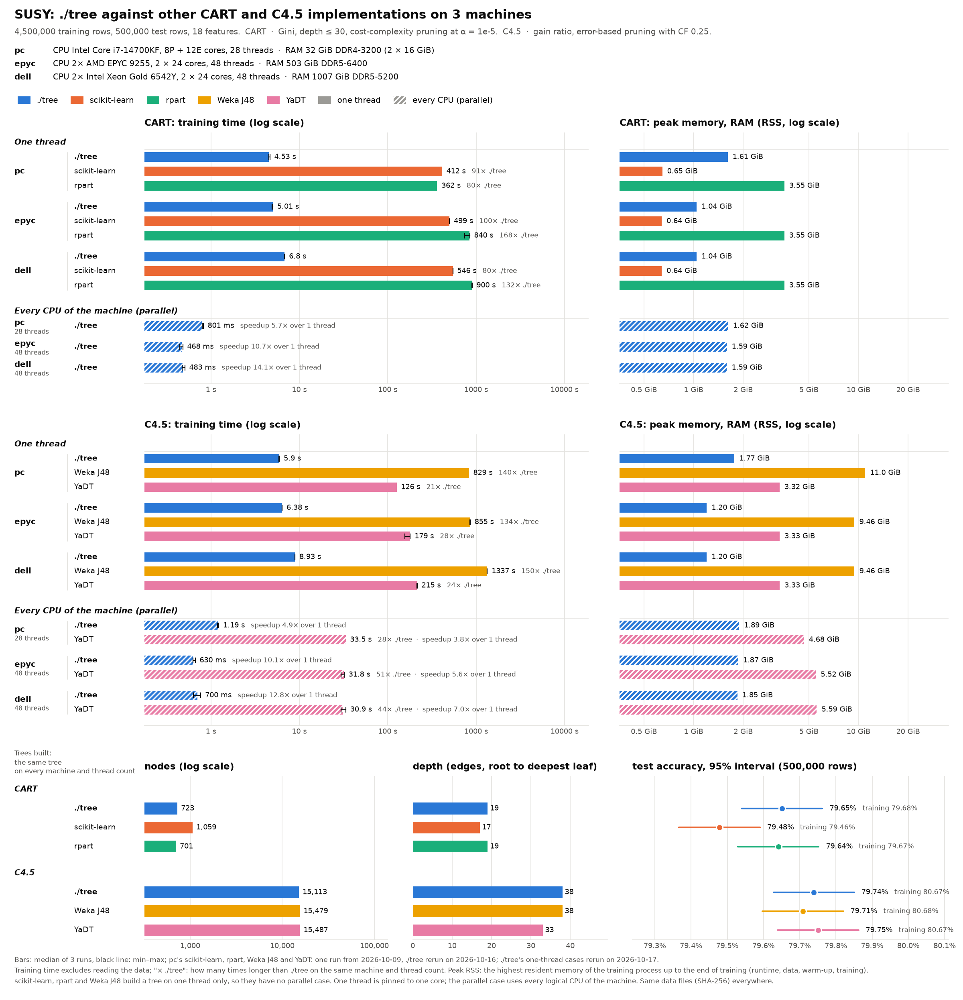

# SUSY benchmark: ./tree vs CART and C4.5 implementations on three machines

**Status:** run on 2026-10-16 on mordor3's epyc1 and dell1 (every tool, 3 runs per case, commit 3cbdb6f) and on the desktop (./tree only, 3 runs per case, commit 45cd3c3; the other tools' rows are the desktop's runs of 2026-10-09, one run each). Results at the end; files in `pc/`, `epyc/`, `dell/`.

**./tree rerun on 2026-10-17 on epyc1 and dell1** (`run.sh <machine> -t -m 3`, commit cd18717, 19:27 and 20:00): the presorted columns are kept once, with one spare column slot on one thread and min(features − 1, threads) on all of them ([docs/CPU.md](../../../docs/CPU.md)). Every ./tree row of `epyc/` and `dell/` is from that rerun (`machine.json` → `tree_rerun`), every other tool's row from the runs above. Before (the one-thread rows of the serial rerun on 3bd3a46, the 48-thread rows of 3cbdb6f) → after, median of 3: CART one thread 4.98 → 5.01 s (epyc), 6.84 → 6.80 s (dell); C4.5 6.77 → 6.38 s, 9.06 → 8.93 s; CART 48 threads 0.49 → 0.47 s, 0.56 → 0.48 s; C4.5 0.61 → 0.63 s, 0.72 → 0.70 s. Peak RSS on one thread 1.61 → 1.04 GiB (CART) and 1.77 → 1.20 GiB (C4.5), on 48 threads 1.63 → 1.59 GiB and 1.87–1.88 → 1.85–1.87 GiB. The same trees.

**The desktop's ./tree rows were not rerun:** its one-thread rows are from the serial rerun of 2026-10-17 (`bench/serial_rerun.py`, commit 3bd3a46: `--serial` with the parallel backend's out-of-place partition and a second copy of the columns), its 28-thread rows from 45cd3c3.



## Run it

```bash
bench/results/cluster-susy-vs-others-cpu/run.sh pc -m 3      # on the desktop
bench/results/cluster-susy-vs-others-cpu/run.sh epyc -m 3    # on mordor3's login node: submits a whole-node SLURM job
bench/results/cluster-susy-vs-others-cpu/run.sh dell -m 3
bench/results/cluster-susy-vs-others-cpu/run.sh pc -t -m 3   # ./tree only, keeping the other tools' rows
bench/.venv/bin/python bench/vs_others_chart.py bench/results/cluster-susy-vs-others-cpu   # chart.png, summary.csv
```

- **Time:** with `-m 3`, about 2 h on epyc1 and 2¾ h on dell1; ./tree alone takes a minute. Per run on full SUSY: J48 14–22 min, rpart 6–15 min, scikit-learn 7–9 min, YaDT 2–3.5 min (1 thread) or ~30 s (all threads), ./tree 1–11 s.
- **What `run.sh` does:**
  1. Refuses to overwrite existing results (`-t`: needs them).
  2. Builds the tools (`bench/setup.sh`; on mordor3 once on the login node, before the job is queued).
  3. Runs the benchmark, full SUSY only:
     `bench/run.py susy --protocols cart_alpha,c45 --impls tree,sklearn,rpart,j48,yadt --threads 1,all --cpus <machine> --reps <-m> --timeout 3600 --warmup-rows 50000 --java-heap 15g`
  4. Writes `report.md`, `summary.csv` and `runs.csv` of that machine.
- **`-t`** runs ./tree alone into `<machine>/tree-rerun`, then replaces the ./tree rows of `<machine>/results.jsonl` with its rows and records the rerun in `machine.json` → `tree_rerun` (`report.py` and the chart give both dates).
- **On mordor3** the job takes the whole node (`--exclusive`, `-w epyc1` or `-w dell1`, 12 h limit) and runs the same script there; its log is `<machine>/run.log`. The nodes have no R: R 4.6.1 and OpenJDK 17 come from a micromamba environment in the home directory, rpart 4.1.27 is built from CRAN's source into it:

  ```bash
  micromamba create -n dtbench -c conda-forge r-base=4.6.1 openjdk=17
  curl -sSfLO https://cran.r-project.org/src/contrib/rpart_4.1.27.tar.gz
  PATH=~/micromamba/envs/dtbench/bin:$PATH R CMD INSTALL rpart_4.1.27.tar.gz
  ```

  `run.sh` puts `$BENCH_ENV/bin` (default `~/micromamba/envs/dtbench`) first in `PATH`. SUSY was prepared on dell1 (`bench/cluster/prepare-susy.log`); every file has the desktop's SHA-256.
- **Outputs:**

  | File | Content |
  |---|---|
  | `chart.png` | All machines: time and peak RSS per tool, then the trees |
  | `summary.csv` | One row per machine and case |
  | `<machine>/report.md` | That machine's tables |
  | `<machine>/summary.csv`, `runs.csv` | One row per case, per process |
  | `<machine>/results.jsonl` | Raw rows with the exact commands |
  | `<machine>/machine.json` | Hardware and versions (`tree_rerun`: the ./tree rerun) |
  | `<machine>/plan.json` | Settings and SHA-256 of every data file |
  | `<machine>/run.log` | Everything `run.sh` printed |

## Method

### Implementations

| Algorithm | Implementation | Threads |
|---|---|---|
| CART | **./tree** (this repository) | 1 (`--serial`), all (`--parallel`) |
| CART | scikit-learn 1.9.1 `DecisionTreeClassifier` | 1 |
| CART | rpart 4.1.27 (R 4.6.1) | 1 |
| C4.5 | **./tree** | 1, all |
| C4.5 | Weka 3.8.7 J48 (OpenJDK 17) | 1 |
| C4.5 | YaDT 2.3.0 | 1, all (`-tt`) |

- **Single-threaded tools:** scikit-learn, rpart and J48 build a tree on one thread only, so they have no parallel case.
- **Separate panels:** one-thread and all-thread results are never compared with each other; "× ./tree" always compares with ./tree on the same machine and thread count.
- **No parallel CART competitor.** No other library builds the same pruned CART tree in parallel, so the parallel CART rows hold only ./tree.
  - XGBoost `exact` grows the same unpruned tree (115,607 vs 115,583 nodes on 500k SUSY rows). Its pruning isn't cost-complexity: at the same α it keeps 9,751 nodes against scikit-learn's 3,473.
  - Intel oneDAL does not parallelise a single tree (6.2 s on 1 thread, 5.7 s on 28).
  - Spark MLlib and H2O split on histogram bins.
- **C4.5:** YaDT is the published multicore C4.5 (Aldinucci, Ruggieri, Torquati 2010).
- **CPU only:** `--impls` names the implementations, so ./tree's CUDA build (`tree_cuda`, present on mordor3) never runs.

### Data and evaluation

- **Dataset:** SUSY (Baldi, Sadowski, Whiteson 2014; UCI): 5,000,000 rows, 18 numeric features, 2 classes. Full SUSY only; no subset is run anywhere.
- **Split:** the published one, the last 500,000 rows for testing.

  | Part | Rows | Signal |
  |---|--:|--:|
  | training | 4,500,000 | 45.76% |
  | test | 500,000 | 45.72% |

- **Same data everywhere.** The split was written once per machine by `bench/prepare.py`, with identical SHA-256 on all three (`plan.json`); every tool and every run reads those rows:
  - float32 binary for scikit-learn, rpart and J48;
  - CSV for ./tree and YaDT, printing each float32 value exactly.
- **Checked on every run:** every CSV row is compared with the binary file; every process reports the rows and features it loaded, and a mismatch is an error.
- **Held-out test set:** training accuracy rises with every leaf, so it would reward pruning less. It is still reported, as a consistency check.
- **Precision:** with 500,000 test rows, the 95% interval of an accuracy near 80% is ±0.11 points; smaller differences are noise. The majority class gives 54.28%.
- **No cross-validation:** every case grows one tree on the training rows.

### Settings

| | Settings |
|---|---|
| **CART** (`cart_alpha`) | Gini, binary splits, depth ≤ 30 (rpart's limit), one tree pruned by cost-complexity at a fixed **α = 1e-5**, the same number for every tool, no cross-validation. |
| ./tree | `--cart -d 30 --alpha 1e-05` |
| scikit-learn | `criterion="gini", max_depth=30, ccp_alpha=1e-5` |
| rpart | `split="gini", minsplit=2, minbucket=1, cp=0, maxcompete=0, maxsurrogate=0, xval=0, maxdepth=30`, then `prune(cp = α·n / root risk)` |
| **C4.5** (`c45`) | Gain ratio, error-based pruning with CF 0.25, subtree raising, at least 2 rows per leaf, no depth limit (J48 has none). |
| ./tree | `--c45` |
| J48 | `-C 0.25 -M 2` |
| YaDT | `-ebpg -c 0.25 -m 2` |

No tool is tuned to match another tool's tree size; each reports the tree it builds.

### Training time

**Wall time measured inside each tool**, from "training data in memory, in the tool's own format" to "final pruned tree":

| Tool | Timed | Inside the timer |
|---|---|---|
| ./tree | `train total` | presort, build, prune |
| scikit-learn | `fit()` | build, pruning (incl. its internal sorting) |
| rpart | `rpart()` + `prune()` | data-frame conversion, build, prune |
| J48 | `buildClassifier()` | data copy, build, pruning |
| YaDT | its log: indexing + build + prune | indexing, build, prune |

- **Left out for every tool:** process start-up, reading the file, building the input structure, and prediction.
- **Warm-up:** scikit-learn, rpart and J48 fit one untimed tree on the first 50,000 training rows in the same process (code loading, JVM JIT). ./tree and YaDT need none. A warm-up on all rows would put a whole extra tree into J48's peak RSS.
- **Reported numbers:** median and min–max over the runs; the ratio to ./tree on the same machine and thread count.

### Peak memory

**Peak RSS of the process** (`VmHWM`, read by each tool right after training, before it loads the test set). It counts everything: runtime, input data, parser, the warm-up and the training structures.

- YaDT, a closed binary, can't read its own peak: its measured process only trains and saves the tree, and its whole-process peak is used. A second, unmeasured process classifies the test rows.
- Every process is started by a tiny launcher (`bench/adapters/rusage.c`): a child forked from the Python harness would inherit its peak RSS.
- **J48's heap** is capped at 15 GB (`-Xmx15g`) on every machine. The default, half the RAM, would be 250–500 GB on the servers, and the JVM grows its heap rather than collect early. J48's peak is an upper bound of what it needs.

### Tree size and accuracy

- **Every run reports**, after its timer stops: nodes, leaves, depth, training and test accuracy; across the runs and machines they must be identical, and they are.
- **Nodes** = internal nodes + leaves; leaves = (nodes + 1) / 2. **Depth** = edges from the root to the deepest leaf.
- **Accuracy:** each tool predicts with its own code. YaDT's comes from its confusion matrices.

### Machines

| | pc (desktop) | epyc (mordor3 epyc1) | dell (mordor3 dell1) |
|---|---|---|---|
| CPU | Intel Core i7-14700KF: 8 performance cores (CPUs 0–15, two threads each, ≤ 5.6 GHz) + 12 efficiency cores (CPUs 16–27) | 2× AMD EPYC 9255 (Zen 5), 2 × 24 cores, no SMT | 2× Intel Xeon Gold 6542Y (Emerald Rapids), 2 × 24 cores, no SMT |
| RAM | 32 GiB DDR4-3200, dual channel | 512 GB DDR5-6400 | 1 TB DDR5-5200 |
| All threads | 28 | 48 | 48 |
| 1 thread pinned to | CPU 2 (a performance core) | CPU 0 | CPU 0 |
| Governor | `performance` | `performance` | `powersave` (intel_pstate, still boosts; set by the admins) |
| System | Arch Linux, kernel 7.2.9 | Ubuntu 24.04, kernel 7.0 | Ubuntu 24.04, kernel 7.0 |
| ./tree built with | g++ 16.2.1 `-O3` | g++ 13.3 `-O3` | g++ 13.3 `-O3` |
| Python, NumPy, scikit-learn | 3.14.7, 2.5.3, 1.9.1 | 3.12.3, 2.5.3, 1.9.1 | 3.12.3, 2.5.3, 1.9.1 |
| R, rpart | 4.6.1 (Arch), 4.1.27 | 4.6.1 (conda-forge), 4.1.27 | the same |
| Java | OpenJDK 17.0.20.1 | OpenJDK 17.0.18 (conda-forge) | the same |

- **Every case** is a fresh process measuring time and memory together; each repetition runs the cases in a new random order. `OMP/OPENBLAS/MKL_NUM_THREADS=1` for every process. Timeout 1 hour per process (none was reached).
- **Load:** the servers' jobs own their node (`--exclusive`), load average 0.3–0.4 at the start. The ./tree reruns of 2026-10-17 started at 34–36: the one-minute average still counted the previous job on the node (an ECBDL run of ./tree, which had just ended); nothing else ran. The desktop's ./tree rerun started at load 2.4 (this session's own tools); its other tools ran on 2026-10-09 at load 1.2–4.2.

## Results

Run on 2026-10-16, ./tree's rows on epyc and dell rerun on 2026-10-17 (cd18717, above). Training time is the median of 3 runs (the desktop's scikit-learn, rpart, J48 and YaDT: one run, 2026-10-09), "×" the ratio to ./tree on the same machine and thread count; peak RSS is the median of the same runs.

**CART, one thread:** training time (× ./tree) · peak RSS

| Implementation | pc | epyc | dell |
|---|--:|--:|--:|
| **./tree** | 4.53 s · 1.61 GiB | 5.01 s · 1.04 GiB | 6.80 s · 1.04 GiB |
| scikit-learn | 412 s (91×) · 0.65 GiB | 499 s (100×) · 0.64 GiB | 546 s (80×) · 0.64 GiB |
| rpart | 362 s (80×) · 3.55 GiB | 840 s (168×) · 3.55 GiB | 900 s (132×) · 3.55 GiB |

**CART, every CPU (pc 28, epyc 48, dell 48 threads):** training time (× ./tree) · peak RSS

| Implementation | pc | epyc | dell |
|---|--:|--:|--:|
| **./tree** | 801 ms · 1.62 GiB | 468 ms · 1.59 GiB | 483 ms · 1.59 GiB |

**C4.5, one thread:** training time (× ./tree) · peak RSS

| Implementation | pc | epyc | dell |
|---|--:|--:|--:|
| **./tree** | 5.90 s · 1.77 GiB | 6.38 s · 1.20 GiB | 8.93 s · 1.20 GiB |
| Weka J48 | 829 s (140×) · 11.0 GiB | 855 s (134×) · 9.46 GiB | 1337 s (150×) · 9.46 GiB |
| YaDT | 126 s (21×) · 3.32 GiB | 179 s (28×) · 3.33 GiB | 215 s (24×) · 3.33 GiB |

**C4.5, every CPU (pc 28, epyc 48, dell 48 threads):** training time (× ./tree) · peak RSS

| Implementation | pc | epyc | dell |
|---|--:|--:|--:|
| **./tree** | 1.19 s · 1.89 GiB | 630 ms · 1.87 GiB | 700 ms · 1.85 GiB |
| YaDT | 33.5 s (28×) · 4.68 GiB | 31.8 s (51×) · 5.52 GiB | 30.9 s (44×) · 5.59 GiB |

**The trees** are the same on every machine and thread count:

| Algorithm | Implementation | Nodes | Depth | Train acc. | Test acc. |
|---|---|--:|--:|--:|--:|
| CART | ./tree | 723 | 19 | 79.68% | 79.65% |
| CART | scikit-learn | 1,059 | 17 | 79.46% | 79.48% |
| CART | rpart | 701 | 19 | 79.67% | 79.64% |
| C4.5 | ./tree | 15,113 | 38 | 80.67% | 79.74% |
| C4.5 | Weka J48 | 15,479 | 38 | 80.68% | 79.71% |
| C4.5 | YaDT | 15,487 | 33 | 80.67% | 79.75% |

**Reading the results**

- **Speed, one thread:** ./tree is 80–100× faster than scikit-learn, 80–168× faster than rpart, 134–150× faster than J48 and 21–28× faster than YaDT.
- **Speed, every CPU:** ./tree builds the CART tree in 0.47 s (epyc), 0.48 s (dell) and 0.80 s (pc), the C4.5 tree in 0.63, 0.70 and 1.19 s; YaDT needs 31–34 s, 28–51× longer.
- **Speedup over one thread:** ./tree 10.1–10.7× on epyc, 12.8–14.1× on dell, 4.9–5.7× on the desktop; YaDT 5.6×, 7.0× and 3.8×. Dell's larger speedups come from its slower single thread (./tree 1.4× slower than on epyc), not from a fast parallel run: epyc is the fastest machine in parallel.
- **Machines, one thread:** the desktop is the fastest for ./tree (4.5–5.9 s), epyc 1.1× slower (5.0–6.4 s); dell is 1.4× slower than epyc for ./tree, 1.1–1.6× for the other tools.
- **rpart is 2.3–2.5× slower on the servers** (840 and 900 s against 362 s), much more than the other tools (scikit-learn 1.2–1.3×). Not because of its build: the servers' conda-forge R, with rpart built the same way, timed on the desktop's CPU 2 on 2026-10-17 (a check outside the benchmark, one run each, governor `powersave`), took 410 s against 368 s for Arch's R: 12% slower, the same tree. So the servers' single core is about 2× slower for rpart, while it is within 1.1× of the desktop for ./tree (epyc) — probably because rpart is bound by memory latency, which is higher on the two-socket servers, and ./tree by bandwidth.
- **Memory:** the other tools' peaks are the same on every machine for one thread, except J48, whose heap fills to 9.5 GiB on the servers and 11.0 GiB on the desktop (the same 15 GB cap). scikit-learn has the lowest peak for CART (0.65 GiB against ./tree's 1.04 GiB on the servers): ./tree keeps every feature presorted, one copy plus a spare column (1.61 GiB on the desktop, whose rows are still from the two-copy code). For C4.5 ./tree needs the least (1.20 GiB on the servers, 1.77 on the desktop, against YaDT's 3.3 and J48's 9.5–11 GiB); in parallel 1.6–1.9 GiB against YaDT's 4.7–5.6 GiB.
- **Accuracy:** every tool is within the ±0.11-point interval of the others except scikit-learn's CART (79.48%), whose α is in Gini units and prunes to a different tree.
- **./tree on the desktop since the last run** (2026-10-10, commit 49b7f47; one thread before the serial rerun): CART 6.18 → 4.63 s on one thread, 0.90 → 0.80 s on 28; C4.5 6.15 → 5.99 s and 1.20 → 1.19 s; peak RSS 3–14% lower; the same trees.

### Caveats for the paper

- **The desktop's other tools ran once** (2026-10-09, not a quiet PC: load 1.2–4.2), the servers' three times.
- **α units:** scikit-learn measures α in Gini impurity, ./tree and rpart in misclassified rows, so the same α prunes scikit-learn's tree to a different size.
- **Depth cap:** CART is capped at depth 30 for every tool because rpart cannot grow deeper; no tree here reaches it.
- **YaDT** is a closed binary: its times come from its own log.
- **R's timer** (`Sys.time`) is a wall clock, accurate at the scale of seconds.
- **One published split:** accuracy differences carry the ±0.11-point uncertainty above.
- **History:** the desktop-only versions of this benchmark (`cpu-pc-susy-vs-others`, and `cpu-pc-susy500k-vs-others` on a 500k-row subset) are in the git history up to commit b347761.
