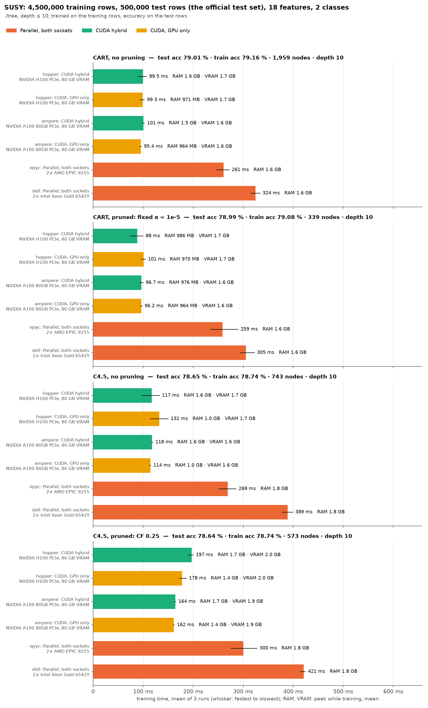

# SUSY (18 features): training set and test set

./tree only, trained on the training rows and scored on the test rows
([bench/cluster/README.md](../../cluster/README.md#test-set-benchmarks)).

- **Training rows:** the first 4,500,000 rows.
- **Test rows:** the last 500,000, UCI's test set.
- **Protocols:** depth ≤ 10; CART without pruning and pruned at α = 1e-5, C4.5 without pruning and pruned at CF 0.25.
- **Runs:** CUDA hybrid and GPU only on hopper (H100) and ampere (A100 80 GB), parallel on every CPU of both sockets on epyc1 and dell1; no serial runs. Three runs per case, averaged.
- **Measured:** ./tree's training time, peak RAM while training, peak VRAM; the tree's test and training accuracy, nodes and depth.
- **Chart:** `chart.png`, `bench/testset_chart.py`.

## Results

Run on 2026-10-23 at 74a011f. Each case ran 3 times; the tables give means of ./tree's training time. Accuracies, nodes and depth are the same in every run.

- **Same tree everywhere:** every backend grew the same tree in every case.
- **Speed:** both GPUs take 0.09–0.20 s, a near-fixed cost at 4.5M rows (the A100 matches the H100). That is 1.5–3× faster than epyc (0.26–0.30 s).
- **Accuracy:** CART reaches 79.0% on the test set, C4.5 78.6%. Pruning cuts CART from 1,959 to 339 nodes and costs 0.02 points.
- **Memory:** VRAM 1.6–2.0 GiB; RAM at most 1.8 GiB everywhere.

| Protocol | test acc | train acc | nodes | depth |
|---|---|---|---|---|
| CART, no pruning | 79.01% | 79.16% | 1,959 | 10 |
| CART, α 1e-5 | 78.99% | 79.08% | 339 | 10 |
| C4.5, no pruning | 78.65% | 78.74% | 743 | 10 |
| C4.5, CF 0.25 | 78.64% | 78.74% | 573 | 10 |

| Run | CART, no pruning | CART, α 1e-5 | C4.5, no pruning | C4.5, CF 0.25 | RAM GiB (peak, range over protocols) | VRAM GiB (peak, range over protocols) |
|---|---|---|---|---|---|---|
| hopper, CUDA hybrid | 0.0995 s | 0.088 s | 0.117 s | 0.197 s | 1.0–1.7 | 1.7–2.0 |
| hopper, GPU only | 0.0993 s | 0.101 s | 0.132 s | 0.178 s | 0.9–1.4 | 1.7–2.0 |
| ampere, CUDA hybrid | 0.101 s | 0.0967 s | 0.118 s | 0.165 s | 1.0–1.7 | 1.6–1.9 |
| ampere, GPU only | 0.0954 s | 0.0962 s | 0.114 s | 0.162 s | 0.9–1.4 | 1.6–1.9 |
| epyc, parallel | 0.261 s | 0.259 s | 0.269 s | 0.3 s | 1.6–1.8 | – |
| dell, parallel | 0.324 s | 0.305 s | 0.389 s | 0.421 s | 1.6–1.8 | – |
