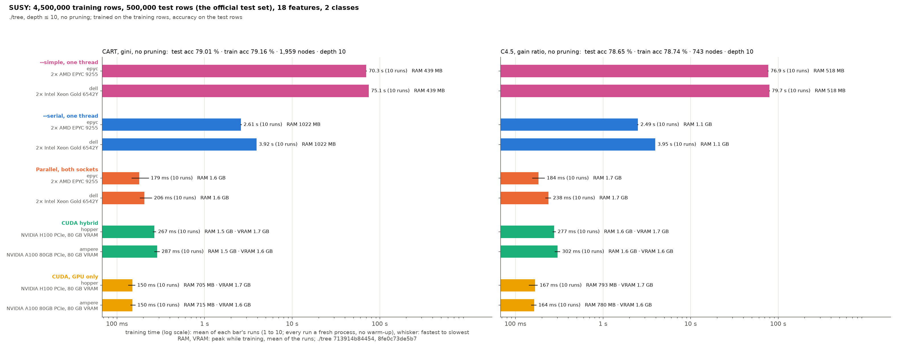

# SUSY (18 features): training set and test set

./tree only, trained on the training rows and scored on the test rows
([bench/cluster/README.md](../../cluster/README.md#test-set-benchmarks)).

- **Training rows:** the first 4,500,000 rows.
- **Test rows:** the last 500,000, UCI's test set.
- **Protocols:** depth ≤ 10, CART (gini) and C4.5 (gain ratio), both without pruning.
- **Runs:** CUDA `--hybrid` and `--gpu` (GPU only) on hopper (H100) and ampere (A100 80 GB), with every CPU of the node; on epyc (2× EPYC 9255) and dell (2× Xeon Gold 6542Y): `--multicore` on both sockets (48 threads), `--serial` and `--simple` (one thread). 10 runs a case, each a fresh process with no warm-up, in a shuffled, interleaved order.
- **Builds:** ./tree at 8fe0c73d (CPU runs) and e55af94f (GPU runs: the same tree code plus `--gpu-startup`), one build for every node, run on 2026-11-17 by `bench/cluster/final.sh -D higgs,susy` ([bench/cluster/README.md](../../cluster/README.md#the-final-rerun)): `--multicore` on epyc1 and dell1, `--serial` on epyc2 and dell3, `--simple` on epyc1 and dell3, CUDA on hopper and ampere. The GPU runs time ./tree's GPU setup (kernel loading, memory pool, page-locked staging buffers, copy threads) by the rule every GPU tool follows: only the bare CUDA context is untimed (`--gpu-startup context`, [bench/README.md](../../README.md#how-time-is-measured)). The 2026-11-15 runs (f53347a9, 5 runs a case) are in git at 7d906f7d.
- **Measured:** ./tree's training time (presort, build; not reading the CSV), peak RAM while training, peak VRAM; the tree's test and training accuracy, nodes, depth and SHA-256.
- **Chart:** `chart.png`, `bench/testset_chart.py` (log scale).

## Results

Every run of a case grew the same tree (the same `tree_sha256`). The tables give the mean of ./tree's training time (`bench/testset_chart.py --table`); "runs" is the number of runs of the case, also on the chart.

- **Speed:** both GPUs take 255–310 ms, nearly all of it the GPU setup (227–260 ms: kernel loading, memory pool, staging buffers, a fixed cost); the build takes 26–51 ms. epyc's `--multicore` takes 179 and 184 ms, 1.4–1.7× faster than the GPUs: at 4.5M rows the GPU's fixed setup outweighs its faster build. dell takes 206 and 238 ms, 1.15–1.3× epyc.
- **Serial and simple:** `--serial` takes 2.61 s (CART) and 2.49 s (C4.5) on epyc, 14–15× `--multicore`, and 3.92 s and 3.95 s on dell. `--simple`, the reference, takes 70–80 s: 27–31× `--serial` on epyc, 19–20× on dell.
- **Against the 2026-11-15 runs (7d906f7d):** `--serial` and `--simple` within 1%; `--multicore` 7–10% slower on epyc and 19–25% faster on dell (runs of about 0.2 s, 5 runs a case before, which spread up to ±15%). The GPU runs take 0.19–0.23 s more: the setup that was untimed before (see Builds).
- **Accuracy:** CART reaches 79.0% on the test set, C4.5 78.7%.
- **Memory:** VRAM 1.6–1.7 GB; RAM at most 1.6 GB everywhere (GPU only and `--serial` 1.0 GB, `--simple` 0.5 GB).

| Protocol | test acc | train acc | nodes | depth |
|---|---|---|---|---|
| CART, no pruning | 79.01% | 79.16% | 1,959 | 10 |
| C4.5, no pruning | 78.65% | 78.74% | 743 | 10 |

| Run | runs | CART | C4.5 | RAM GB (peak) | VRAM GB (peak) |
|---|---|---|---|---|---|
| epyc, --simple, one thread | 10 | 70.3 s | 76.9 s | 0.5 | – |
| dell, --simple, one thread | 10 | 75.1 s | 79.7 s | 0.5 | – |
| epyc, --serial, one thread | 10 | 2.61 s | 2.49 s | 1.0 | – |
| dell, --serial, one thread | 10 | 3.92 s | 3.95 s | 1.0 | – |
| epyc, parallel, both sockets | 10 | 179 ms | 184 ms | 1.6 | – |
| dell, parallel, both sockets | 10 | 206 ms | 238 ms | 1.6 | – |
| hopper, CUDA hybrid | 10 | 255 ms | 262 ms | 1.6 | 1.7 |
| ampere, CUDA hybrid | 10 | 296 ms | 310 ms | 1.6 | 1.6 |
| hopper, CUDA, GPU only | 10 | 256 ms | 282 ms | 1.0 | 1.7 |
| ampere, CUDA, GPU only | 10 | 289 ms | 303 ms | 1.0 | 1.6 |
