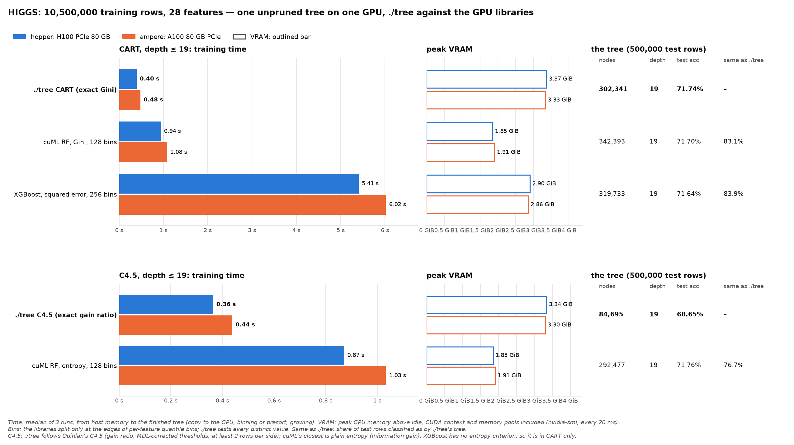
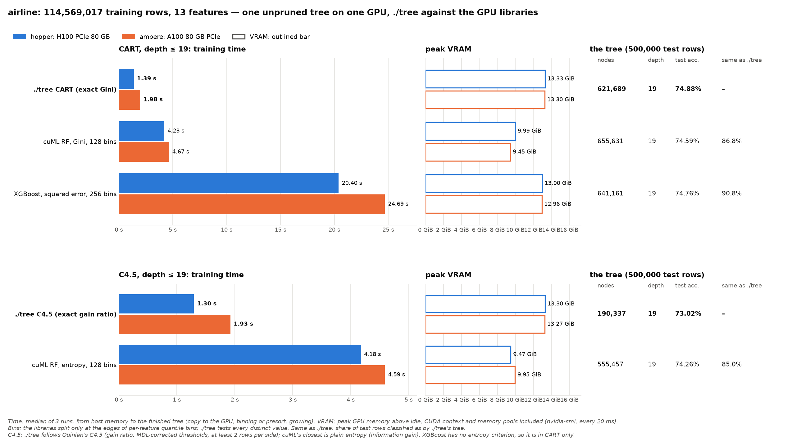
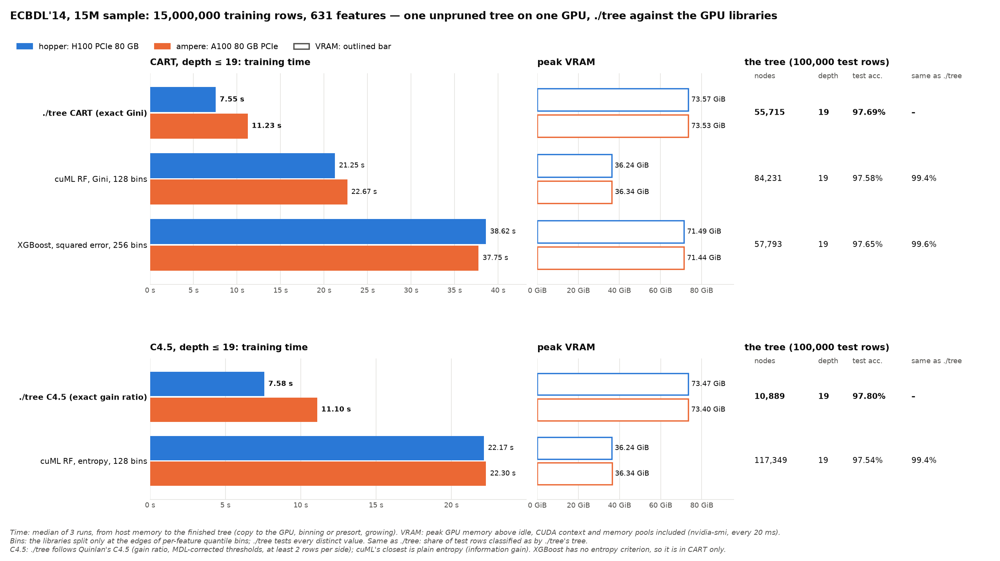

# HIGGS, airline and ECBDL'14 on the mordor3 GPUs: ./tree against other GPU decision-tree builders

**Status:** run on 2026-10-17, 3 runs per case. The libraries ran from 12:44 with ./tree at commit 00ae13f; **./tree's rows were rerun on 2026-10-19 (15:45–16:05) on 051949b** (cd18717's one copy of the presorted columns on the GPU, [docs/PERFORMANCE.md](../../../docs/PERFORMANCE.md), plus `--profile` and the count tables' fill), built for sm_80 and sm_90 in a separate clone (`~/gpu-dt-bench/dt`). The trees are the same as before, node for node, and so are the test predictions; `machine.json` → `tree_rerun` records the rerun. Against the previous rerun (cd18717, 2026-10-17 17:54) ./tree's times moved within −3.5% to +2.3%. Both GPU servers ran CUDA only, on GPU 0, with the whole node held through `--exclusive`. **ECBDL'14's 15M-row sample was added on 2026-10-18** (15:19–15:27, one job per node, the libraries with ./tree on cd18717 in the same job, 3 runs per case; ./tree's rows rerun with the others on 051949b). **One unpruned tree with depth ≤ 19 per case, CART and C4.5, on HIGGS, airline and ECBDL.** 19 is the depth of ./tree's pruned CART tree on HIGGS. Each library runs with its default bins, its faster setting; the earlier 1024-bin runs were slower and agreed with ./tree only 1–2 points more.

**Bottom line:** ./tree is the fastest single-tree GPU builder found, and the only one with exact splits.
- **Against cuML (the fastest of the others):** 2.2–2.4× faster on HIGGS, 2.4–3.2× on airline and 2.0–2.9× on ECBDL, for CART and for C4.5 against cuML's entropy tree.
- **Against XGBoost (CART only):** 12–15× faster on HIGGS and airline, 3.4–5.1× on ECBDL.
- **CART test accuracy is the same within 0.3 points.** The histogram trees classify 83–91% of test rows the same as ./tree's exact tree on HIGGS and airline, 99.4–99.6% on ECBDL (mostly its 97.8% majority class).
- **C4.5 is a different algorithm from cuML's entropy tree.** ./tree's C4.5 (gain ratio) builds a smaller tree at the same depth limit, with 1.2–3.1 points lower test accuracy (below).
- **Memory:** ./tree uses 3.3–3.4 GiB on HIGGS and 13.3 GiB on airline, against 1.9–2.9 GiB and 9.5–13 GiB for the libraries: 1.8× cuML on HIGGS, 1.3–1.4× cuML and about the same as XGBoost on airline. Before the rerun it used 7.2 and 35 GiB. On ECBDL ./tree fills 73.5 GiB of the 80 GB, against 36 GiB for cuML and 71.5 GiB for XGBoost.







**Bins:** cuML and XGBoost don't test every possible split. Before growing the tree, they sort each feature's values into a fixed number of ranges (bins) with about the same number of rows each, and split only at bin edges. That gives at most 127 (cuML, 128 bins) or 255 (XGBoost, 256 bins) candidate thresholds per feature. ./tree tests every distinct value: millions per feature on HIGGS; on airline, from 7 (DayofWeek) to about 7,900 (FlightNum) in the 500,000 test rows.

## What is compared

I found no public CUDA implementation of C4.5. The GPU C4.5 papers (CUDT, GPU C4.5 for traffic classification) publish no code, and Weka's GPUTree package (Java with CUDA, numeric attributes only) was not tried. Every GPU tree library still in use builds **binary Gini, entropy or second-order-gain trees on histogram bins**.
- **CART** is the same split criterion as the libraries' Gini, but their thresholds are approximate.
- **C4.5's closest library tree is cuML with `split_criterion="entropy"`.** It uses information gain, while C4.5 uses gain ratio with an MDL-corrected threshold. cuML also lacks C4.5's minimum split size of 0.1·n/K rows (clamped to 2–25), and C4.5's collapse of useless splits. cuML is set to C4.5's smallest split, at least 2 rows per side.
- **XGBoost** has no entropy criterion, so it runs CART only.

| Implementation | Version | How it builds one tree |
|---|---|---|
| **./tree --cuda** | 051949b | `--cart --no-prune -d 19`: exact Gini splits over every distinct value (presorted). `--c45 --no-prune -d 19`: Quinlan's C4.5 rules (docs/ALGORITHMS.md), without the error-based pruning. |
| **cuML** `RandomForestClassifier` | 26.10 (RAPIDS, pip `cuml-cu12`) | `n_estimators=1, bootstrap=False, max_features=1.0, n_bins=128` (default). CART: `split_criterion="gini"`, `min_samples_leaf=1`. C4.5: `"entropy"`, `min_samples_leaf=2, min_samples_split=4`. Thresholds are per-feature quantiles. |
| **XGBoost** | 3.4.1, `device="cuda", tree_method="hist"` | One round of `reg:squarederror` on the 0/1 label with `eta=1, lambda=0, alpha=0, gamma=0, min_child_weight=1`, `base_score` = the class-1 share. Every row has hessian 1, so the gain is the drop in squared error, which is n/2 × the drop in Gini impurity: **the CART split, on histogram bins** (`max_bin` 256, the default). `depthwise` growth to the depth limit. |
| CudaTree | 0.6 (2013) | **Not run.** It is Python 2 code, and its kernels use texture references, which CUDA 12 removed. |

Settings shared by every case: all training rows and all features, no bootstrap or feature sampling, no pruning, depth ≤ 19.

| Dataset | Training rows | Features | Test rows |
|---|--:|--:|--:|
| HIGGS | 10,500,000 | 28 (real-valued) | 500,000: the published split's last rows |
| airline (gbm-bench, US flights 1987–2008) | 114,569,017 | 13 (integer) | 500,000: a random sample held out when the data was prepared |
| ECBDL'14, 15M sample ([cluster-ecbdl](../cluster-ecbdl/BENCHMARK.md)) | 15,000,000 | 631 (539 real, 92 nominal as integer codes) | 100,000: a random sample held out when the data was prepared; 2.16% positives |

No tool trains on the test rows, and no extra 80/20 split is needed. On airline, `ActualElapsedTime` partly gives the delay away, so its accuracies say little ([cluster-airlines](../cluster-airlines/BENCHMARK.md)).

### Measurement

- **Time:** from host memory to the finished tree.
  - **./tree:** its `train total` (GPU setup and upload, presort, build). Reading the CSV isn't timed, and the CUDA context is created while the CSV loads. Each run is a fresh process.
  - **Libraries:** one Python process per case. The process first runs one untimed warm-up fit on 50,000 rows (imports, CUDA context, JIT), then 3 timed fits on the full float32 NumPy arrays.
  - **What a library fit includes:** the copy to the GPU and the binning. That is `QuantileDMatrix` for XGBoost; cuML bins inside `fit`.
- **Accuracy:** each library's own `predict`. ./tree's test accuracy comes from its `--dump` tree (`treebench.py`, the same walk as `bench/benchlib.py`).
- **Same as ./tree:** the share of the test rows (500,000; ECBDL 100,000) a tree classifies the same as ./tree's tree in the same case: its CART tree for CART, its C4.5 tree for C4.5.
- **VRAM:** peak `memory.used` of GPU 0 above its idle value (nvidia-smi every 20 ms; the idle value is read before the process starts). It includes the CUDA context and memory pools. For a library it is the peak of the whole process: the warm-up and all 3 fits.
- **Determinism:** every tree is identical on the H100 and the A100. The test predictions are the same, byte for byte.

| Node | CPU | GPU (GPU 0 used) | Driver, CUDA |
|---|---|---|---|
| hopper | 2× Xeon Gold 6444Y, 32 cores | H100 PCIe 80 GB | 615.71.09, CUDA 12.9 |
| ampere | 2× EPYC 7402, 48 cores | A100 80 GB PCIe | 615.71.09, CUDA 12.9 |

## Results

Median of 3 runs (min–max). The node count, depth and accuracies are for the last run's tree, which is the same on both GPUs. The root split is `feature <= threshold` (XGBoost: `<`).

### HIGGS: CART, depth ≤ 19

| Implementation | H100 time | A100 time | Nodes | Depth | Train acc. | Test acc. | Same as ./tree | VRAM H100 | VRAM A100 | Root split |
|---|--:|--:|--:|--:|--:|--:|--:|--:|--:|---|
| ./tree CART (exact Gini) | 0.40 s (0.39–0.43) | 0.48 s (0.47–0.48) | 302,341 | 19 | 77.85% | 71.74% | – | 3.37 GiB | 3.33 GiB | `f25 <= 1.077748` |
| cuML RF, Gini, 128 bins | 0.94 s (0.88–1.89) | 1.08 s (1.07–2.09) | 342,393 | 19 | 77.78% | 71.70% | 83.12% | 1.85 GiB | 1.91 GiB | `f25 <= 1.080328` |
| XGBoost, squared error, 256 bins | 5.41 s (5.13–5.70) | 6.02 s (5.99–6.16) | 319,733 | 19 | 77.79% | 71.64% | 83.95% | 2.90 GiB | 2.86 GiB | `f25 < 1.075816` |

### HIGGS: C4.5, depth ≤ 19

| Implementation | H100 time | A100 time | Nodes | Depth | Train acc. | Test acc. | Same as ./tree | VRAM H100 | VRAM A100 | Root split |
|---|--:|--:|--:|--:|--:|--:|--:|--:|--:|---|
| ./tree C4.5 (exact gain ratio) | 0.36 s (0.36–0.37) | 0.44 s (0.43–0.44) | 84,695 | 19 | 70.43% | 68.65% | – | 3.34 GiB | 3.30 GiB | `f25 <= 1.837873` |
| cuML RF, entropy, 128 bins | 0.87 s (0.87–1.76) | 1.03 s (1.03–2.02) | 292,477 | 19 | 76.73% | 71.76% | 76.72% | 1.85 GiB | 1.91 GiB | `f25 <= 1.080328` |

### airline: CART, depth ≤ 19

| Implementation | H100 time | A100 time | Nodes | Depth | Train acc. | Test acc. | Same as ./tree | VRAM H100 | VRAM A100 | Root split |
|---|--:|--:|--:|--:|--:|--:|--:|--:|--:|---|
| ./tree CART (exact Gini) | 1.39 s (1.38–1.39) | 1.98 s (1.97–1.99) | 621,689 | 19 | 75.31% | 74.88% | – | 13.33 GiB | 13.30 GiB | `f8 <= 70.5` |
| cuML RF, Gini, 128 bins | 4.23 s (4.20–8.23) | 4.67 s (4.67–8.56) | 655,631 | 19 | 75.00% | 74.59% | 86.80% | 9.99 GiB | 9.45 GiB | `f8 <= 70` |
| XGBoost, squared error, 256 bins | 20.40 s (20.21–20.58) | 24.69 s (24.54–24.85) | 641,161 | 19 | 75.20% | 74.76% | 90.80% | 13.00 GiB | 12.96 GiB | `f8 < 71` |

### airline: C4.5, depth ≤ 19

| Implementation | H100 time | A100 time | Nodes | Depth | Train acc. | Test acc. | Same as ./tree | VRAM H100 | VRAM A100 | Root split |
|---|--:|--:|--:|--:|--:|--:|--:|--:|--:|---|
| ./tree C4.5 (exact gain ratio) | 1.30 s (1.29–1.32) | 1.93 s (1.89–1.93) | 190,337 | 19 | 73.15% | 73.02% | – | 13.30 GiB | 13.27 GiB | `f8 <= 70` |
| cuML RF, entropy, 128 bins | 4.18 s (4.12–6.88) | 4.59 s (4.58–8.55) | 555,457 | 19 | 74.58% | 74.26% | 84.98% | 9.47 GiB | 9.95 GiB | `f8 <= 70` |

### ECBDL'14 15M sample: CART, depth ≤ 19

| Implementation | H100 time | A100 time | Nodes | Depth | Train acc. | Test acc. | Same as ./tree | VRAM H100 | VRAM A100 | Root split |
|---|--:|--:|--:|--:|--:|--:|--:|--:|--:|---|
| ./tree CART (exact Gini) | 7.55 s (7.51–7.55) | 11.23 s (11.20–11.34) | 55,715 | 19 | 98.22% | 97.69% | – | 73.57 GiB | 73.53 GiB | `f0 <= 40.5` |
| cuML RF, Gini, 128 bins | 21.25 s (20.87–41.51) | 22.67 s (21.63–53.83) | 84,231 | 19 | 81.08%* | 97.58% | 99.38% | 36.24 GiB | 36.34 GiB | `f0 <= 40` |
| XGBoost, squared error, 256 bins | 38.62 s (38.03–40.60) | 37.75 s (37.38–38.48) | 57,793 | 19 | 98.23% | 97.65% | 99.58% | 71.49 GiB | 71.44 GiB | `f0 < 41` |

### ECBDL'14 15M sample: C4.5, depth ≤ 19

| Implementation | H100 time | A100 time | Nodes | Depth | Train acc. | Test acc. | Same as ./tree | VRAM H100 | VRAM A100 | Root split |
|---|--:|--:|--:|--:|--:|--:|--:|--:|--:|---|
| ./tree C4.5 (exact gain ratio) | 7.58 s (7.47–7.62) | 11.10 s (11.10–11.18) | 10,889 | 19 | 97.93% | 97.80% | – | 73.47 GiB | 73.40 GiB | `f34 <= 0` |
| cuML RF, entropy, 128 bins | 22.17 s (20.64–44.37) | 22.30 s (21.34–50.08) | 117,349 | 19 | 91.18%* | 97.54% | 99.39% | 36.24 GiB | 36.34 GiB | `f0 <= 54` |

\* cuML's `predict` on all 15M training rows at once overflows (Observations); in 1M-row chunks: 98.31% (CART), 98.27% (entropy).

## Observations

- **./tree is the fastest in every case, and the gap grows with the data.**
  - **CART, H100:** HIGGS 0.40 s against 0.94 s for cuML (2.4×) and 5.41 s for XGBoost (13.7×). Airline 1.39 s against 4.23 s (3.0×) and 20.4 s (14.7×).
  - **CART, A100:** 2.2× and 12.5× on HIGGS, 2.4× and 12.5× on airline.
  - **C4.5 against cuML's entropy tree:** 2.3–2.4× on HIGGS and 2.4–3.2× on airline.
- **CART: same accuracy, different trees.**
  - **Test accuracy:** HIGGS 71.64–71.74% for every tree, airline 74.59–74.88%. ./tree's exact tree is the most accurate on both, by at most 0.3 points.
  - **Tree size:** about the same. HIGGS gives 302,341 nodes for ./tree and 319,733–342,393 for the others; airline gives 621,689 against 641,161–655,631.
  - **Agreement with ./tree:** 83–84% of test rows on HIGGS and 87–91% on airline. Airline's integer features have few distinct values (the root's feature, `ActualElapsedTime`, has 587 in the test rows), so bin edges land closer to the exact thresholds. Even so, the root threshold differs (./tree 70.5, cuML 70, XGBoost < 71).
- **C4.5 against entropy: a smaller tree with lower accuracy at depth 19.**
  - **Smaller trees:** ./tree's C4.5 has 84,695 nodes on HIGGS and 190,337 on airline, against 292,477 and 555,457 for cuML's entropy tree.
  - **Lower accuracy:** test accuracy is 68.65% against 71.76% on HIGGS, and 73.02% against 74.26% on airline.
  - **The reason is C4.5's own rules.** Gain ratio prefers uneven splits: on HIGGS its root is `f25 <= 1.837873`, against 1.08 for every Gini and entropy tree. Uneven splits use up the 19 levels on few rows. C4.5's minimum split size (up to 25 rows per side) and its collapse of useless splits stop it earlier still. Without the depth limit C4.5 grows deeper (depth 74 on airline, [cluster-airlines](../cluster-airlines/BENCHMARK.md)).
  - **Agreement:** the two trees agree on only 77% (HIGGS) and 85% (airline) of test rows.
  - **Timing still compares the same amount of data.** Every case reads the same rows, and ./tree's smaller C4.5 tree takes about as long as its CART tree.
- **ECBDL'14 (631 features, 15M rows): ./tree still the fastest, the libraries closer.**
  - **CART:** 7.55 s on the H100 against 21.3 s for cuML (2.8×) and 38.6 s for XGBoost (5.1×); on the A100 11.2 s against 22.7 s (2.0×) and 37.8 s (3.4×). **C4.5 against cuML's entropy tree:** 7.58 against 22.2 s (2.9×) on the H100, 11.1 against 22.3 s (2.0×) on the A100.
  - **The libraries gain nothing from the H100** (cuML 21.3 against 22.7 s, XGBoost 38.6 against 37.8 s), ./tree 1.5×. ./tree's time is GPU work ([cluster-ecbdl-profile](../cluster-ecbdl-profile/BENCHMARK.md): 0.7 s of upload on the H100, 1.7 s on the A100, then the kernels). What bounds the libraries' fits (the binning, the copy to the GPU, the host) was not profiled.
  - **Accuracy says little here.** 97.84% of the test rows are negatives, and every depth-19 tree is below always predicting the majority class: CART 97.58–97.69%, C4.5 97.80%, cuML's entropy tree 97.54%. The trees agree with ./tree on 99.4–99.6% of the test rows.
  - **Trees:** CART 55,715 nodes for ./tree, 57,793 for XGBoost, 84,231 for cuML; C4.5 10,889 against 117,349 for cuML's entropy tree. ./tree's C4.5 has a different root (`f34 <= 0`, PredSA_freq_central_0) from every Gini and entropy tree (`f0`, the residues' separation).
  - **cuML's training accuracy is not valid** (81.08% and 91.18%, below the majority class): `predict` on all 15M rows at once (9.5 G values) goes wrong from row 6,806,6xx on, about 2³² values / 631 features: a 32-bit index overflow in cuML. Predicted in chunks of 1M rows, the same trees reach 98.31% (CART) and 98.27% (entropy), next to ./tree's 98.22% and 97.93% (a separate job, 2026-10-18; `gpubench.py` now predicts in chunks). The test predictions (100,000 rows) are not affected.
  - **VRAM:** ./tree 73.4–73.6 GiB of the 80 GB (one copy of the presorted columns, 632 slots × 15M rows × 8 bytes = 70.6 GiB, and the rest as on the other datasets), XGBoost 71.4–71.5 GiB, cuML 36.2–36.3 GiB. 15M rows are about the most ./tree fits on these GPUs ([cluster-ecbdl](../cluster-ecbdl/BENCHMARK.md)).
  - **cuML's first full-size fit** took 41.5 and 44.4 s on the H100 (53.8 and 50.1 s on the A100), about 20–31 s more than the next two; the medians leave it out.
- **Memory:** ./tree peaks at 3.3–3.4 GiB on HIGGS and 13.3 GiB on airline: one copy of the presorted columns (8 bytes per value) plus one spare column, a 512 MB hand-off ring and the CUDA context ([docs/CUDA.md](../../../docs/CUDA.md)). cuML uses 1.9 and 9.5–10 GiB, XGBoost 2.9 and 13 GiB. The libraries split on histogram bins and keep no presorted columns, so they need less; ./tree keeps every exact value with its row.
- **./tree on cd18717 against 00ae13f** (the libraries' run, earlier the same day): the GPU memory peak fell from 7.2 to 3.4 GiB (HIGGS) and from 35.0 to 13.3 GiB (airline), 53–62% less, with the same trees. Times moved within −5% to +3% (H100 HIGGS CART 0.39 → 0.39 s, A100 HIGGS C4.5 0.47 → 0.44 s, H100 airline CART 1.37 → 1.38 s and C4.5 1.30 → 1.32 s).
- **H100 against A100:** ./tree is 1.2× faster on the H100 on HIGGS and 1.4–1.5× on airline. The libraries are 1.1–1.2× faster on it.
- **First-run cost:** cuML's first full-size fit in each process took 0.9–4 s longer (max column), probably because its memory pool grows past the 50k-row warm-up size. The medians leave it out.
- **Against the previous run** (35cf315, 2026-10-15, HIGGS CART depth 19 only): ./tree went from 0.42 to 0.39 s on the H100 and from 0.58 to 0.48 s on the A100. cuML (0.96 → 0.94 s) and XGBoost (5.08 → 5.41 s) did not change beyond noise. Its GPU memory peak went from 5.0 to 7.2 GiB: the GPU kept a mirror of the hand-offs to the host when it had room. The rerun on cd18717 replaced that mirror with a fixed 512 MB ring.

## Run it

Everything runs on mordor3 in `~/gpu-dt-bench`, outside this repository. Every computation is a SLURM job on hopper or ampere, with `--exclusive`. The scripts are in [`scripts/`](scripts/). The data is the prepared HIGGS, airline and ecbdl_15m of [bench/cluster](../../cluster/README.md): `~/dt/bench/data/<dataset>`, with `train.csv` for ./tree and `train.f32`/`train.y.i32` and `test.*` for the libraries. The root is set by `DATA_ROOT`.

```bash
# on the mordor3 login node: a clone at the measured commit, the venv, the sources
mkdir ~/gpu-dt-bench && cd ~/gpu-dt-bench
cp /path/to/scripts/* .                      # build.sh job.sh gpubench.py treebench.py summarize.py
git clone ~/dt dt && git -C dt checkout 051949b   # the libraries' rows: 00ae13f (ECBDL: cd18717)
/usr/bin/virtualenv -p python3 venv          # python3-venv is missing on mordor3
venv/bin/pip install --extra-index-url=https://pypi.nvidia.com cuml-cu12 xgboost matplotlib
sbatch build.sh                              # ./tree for sm_80 + sm_90
# the benchmark: about 4 min per node for HIGGS and airline (the default)
# only some: IMPLS="cuml xgboost" DATASETS=airline sbatch --export=ALL ... job.sh <node>
# ECBDL (about 8 min per node): DATASETS=ecbdl_15m sbatch --export=ALL -p hopper --exclusive -t 06:00:00 -o results/hopper-ecbdl_15m.log job.sh hopper
sbatch -p hopper --exclusive -t 03:00:00 -o results/hopper.log job.sh hopper
sbatch -p ampere --exclusive -t 03:00:00 -o results/ampere.log job.sh ampere
```

Then, anywhere with numpy and matplotlib, the tables (`tables.md`), `summary.csv` and the charts `chart-higgs.png`, `chart-airline.png` and `chart-ecbdl_15m.png`:

```bash
venv/bin/python summarize.py results <out dir>
```

- **Results and logs:** the jobs write `results/<dataset>/<node>/results.jsonl` (one line per timed run), `machine.json`, and `failed.jsonl` (cases that crashed, if any). `results.jsonl` and `machine.json` are in `higgs/`, `airline/` and `ecbdl_15m/` here. The job logs stay on mordor3 (`~/gpu-dt-bench/results/<node>.log`, `<node>-ecbdl_15m.log`).
- **Predictions:** the test-set predictions in `results/<dataset>/<node>/pred/` (0.5 MB per tree, ECBDL 0.1 MB) are not kept in the repository.
- **Never `scancel` a running `job.sh` started without `timeout --foreground`.** `timeout` puts the benchmark in its own process group, and SLURM's kill on mordor3 left it running, which happened once here. `job.sh` uses `--foreground`. To stop a case, kill it from inside the job: `srun --jobid=<id> --overlap -n1 kill <pid>`.
- **What was replaced:** this directory was `cluster-higgs-vs-gpu-libs`: HIGGS only, CART only, depth 12 and 19, with 1024-bin runs of both libraries (commit 35cf315, 2026-10-15). Those results are in the git history. The first run of that version also covered LightGBM, which was dropped because its CUDA version ignores the depth limit.
- **Pinned versions:** `scripts/requirements-freeze.txt`.

## Files

| File | Content |
|---|---|
| `chart-higgs.png`, `chart-airline.png`, `chart-ecbdl_15m.png` | Per dataset, CART and C4.5: training time per library and GPU, peak VRAM, and each tree's node count, depth, test accuracy and agreement with ./tree |
| `summary.csv` | One row per dataset, node, case and library: times, tree size, accuracies, agreement, VRAM, root split |
| `higgs/`, `airline/`, `ecbdl_15m/` | `<node>/results.jsonl` (every run), `<node>/machine.json` |
| `scripts/` | `build.sh`, `job.sh` (SLURM), `gpubench.py` (cuML, XGBoost), `treebench.py` (./tree), `summarize.py` (tables and charts), `requirements-freeze.txt` |
