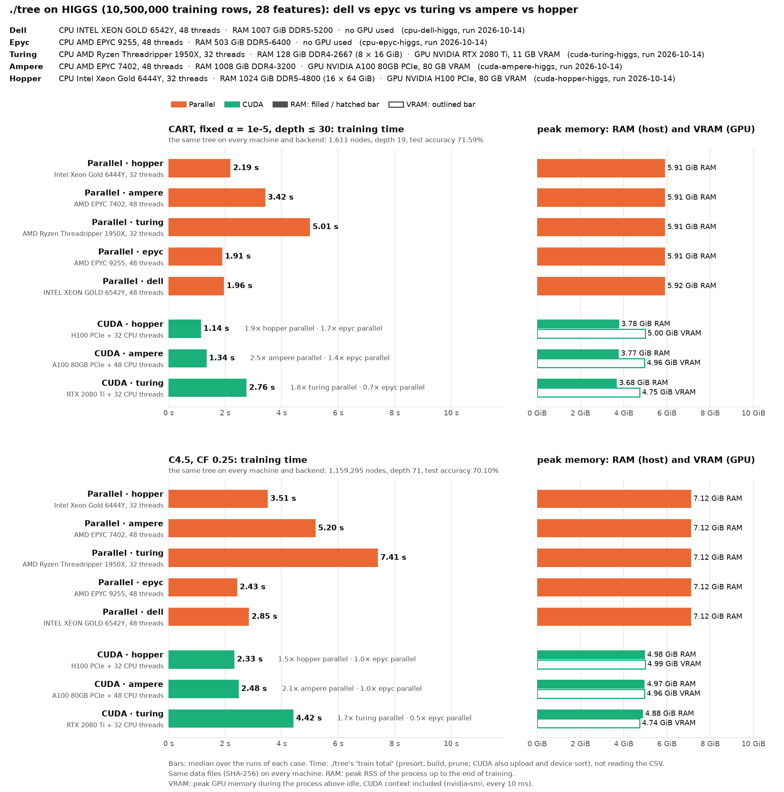

# HIGGS on the mordor3 cluster: ./tree parallel and CUDA on four servers

**Status:** run on 2026-10-14 at 12:45, all four jobs at the same time (each on its own node), 3 runs per case, commit ab8ebdd (627bcc9 plus these scripts). Every case built the same tree on every node and backend, and the prepared data files have the same SHA-256 as on the desktop and the laptop (`cpu-pc-higgs`, `cuda-legion-higgs`).

The mordor3 cluster of the faculty (Politechnika Białostocka, SLURM). Four nodes, each used whole:

| Run | Node | CPU | RAM | GPU | Backends |
|---|---|---|---|---|---|
| `cuda-hopper-higgs` | hopper | 2× Xeon Gold 6444Y, 32 cores | 1 TB DDR5-4800 | 4× H100 PCIe 80 GB (GPU 0 used) | parallel (32 threads), CUDA |
| `cuda-ampere-higgs` | ampere | 2× EPYC 7402, 48 cores | 1 TB DDR4-3200 | 2× A100 80 GB + 2× A100 40 GB PCIe (GPU 0, an 80 GB one, used) | parallel (48 threads), CUDA |
| `cpu-epyc-higgs` | epyc1 | 2× EPYC 9255 (Zen 5), 48 cores | 512 GB DDR5-6400 | – | parallel (48 threads) |
| `cpu-dell-higgs` | dell1 | 2× Xeon Gold 6542Y, 48 cores | 1 TB DDR5-5200 | – | parallel (48 threads) |

None of the nodes has SMT on, so the thread counts are physical cores.

## Run it

On mordor3, in a clone of this repository (`~/dt`). Nothing heavy runs on the login node: every step is a SLURM job.

```bash
# once: the Python venv (python3-venv is missing there; virtualenv is installed)
virtualenv -p python3 bench/.venv && bench/.venv/bin/pip install -r bench/requirements.txt
# once: the downloads, see "Data" below, into ~/downloads
sbatch bench/results/cluster/build.sh          # on hopper: ./tree for sm_80 + sm_90, ./tree_cpu, rusage
sbatch bench/results/cluster/prepare.sh        # on a dell node: the datasets (checked by SHA-256), HIGGS prepared
bench/results/cluster/submit.sh -m 3           # the four benchmark jobs, released together
```

Then copy `bench/results/cluster/` back and draw the chart:

```bash
bench/.venv/bin/python bench/machines_chart.py bench/results/cluster/cuda-hopper-higgs \
    bench/results/cluster/cuda-ampere-higgs bench/results/cluster/cpu-epyc-higgs \
    bench/results/cluster/cpu-dell-higgs --out bench/results/cluster/chart.png
```

- **Time:** 1–1.5 minutes per CPU job and 3.5 minutes per GPU job (both backends), including about 25 s for `run.py`'s check of the data files over NFS.
- **`build.sh`** runs on hopper because the CPU nodes have no CUDA toolkit. It builds with `NVCC=/usr/local/cuda/bin/nvcc CUDA_ARCH="-gencode arch=compute_80,code=sm_80 -gencode arch=compute_90,code=sm_90"`, so one binary serves the A100 and the H100. Log: `build.log`.
- **`submit.sh`** queues one job per node (`job.sh`) with `--exclusive` and `--hold`, then releases them together, so on idle nodes they start in the same second. Each job runs
  `bench/run.py higgs --protocols cart_alpha,c45 --impls tree[,tree_cuda] --threads all --cpus 0-<cores-1> --reps <-m> --timeout 1800 --run-id cluster/<run>`
  and `report.py`. Its log is `<run>/run.log`.

## Method

The protocols, data and measurements of [`cpu-pc-higgs`](../cpu-pc-higgs/BENCHMARK.md), with every core of each node:

| Backend | Command | Threads |
|---|---|---|
| Parallel | `./tree_cpu --parallel --threads N` | N = every core (32 on hopper, 48 elsewhere) |
| CUDA | `./tree --cuda --threads N` | GPU 0, plus N CPU threads for the small subtrees and pruning |

Settings and caveats that are specific to the cluster:
- **Whole nodes.** SLURM on mordor3 hands out cores only: it tracks no GPUs (no GRES) and no memory. Every job therefore takes its node with `--exclusive`, so no other job shares its cores, memory bandwidth or GPUs. At the start of each job the load average was 0.0–0.3 and no process was on any GPU (`run.log`).
- **One GPU.** `CUDA_DEVICE_ORDER=PCI_BUS_ID CUDA_VISIBLE_DEVICES=0`: ./tree uses GPU 0 in nvidia-smi's order. That is the GPU whose memory `run.py` samples (`nvidia-smi --id=0`); on ampere it is an A100 80 GB. The other GPUs sat idle.
- **CPU governors are as the admins set them.** epyc1 `performance`, dell1 `powersave` (intel_pstate, which still boosts), hopper `schedutil`, ampere `ondemand`. A user can't change them; `machine.json` records them. All four dell nodes are set alike (checked on 2026-10-14: `powersave` on all 48 CPUs, intel_pstate, energy-performance preference `balance_performance`, turbo on), so no dell node runs without powersave and dell1 stands for all of them. With intel_pstate, `powersave` is the dynamic governor that still reaches turbo (the hardware picks the frequency), not acpi-cpufreq's `powersave`, which holds the lowest frequency. Most cases' three runs spread by 1–3%; two have one slow run (hopper C4.5 parallel 12%, ampere C4.5 CUDA 13%), and the medians are kept.
- **Hopper has no git.** `submit.sh` records the commit on the login node, and `run.py` takes it from `TREE_GIT_DESCRIBE`.
- **Data over NFS.** /home is NFS. Reading the CSV is not timed, so this only lengthens the wall time.
- **RAM in the chart** is the kernel's MemTotal with the module type and speed. udev's DMI list, the usual source, is cut short on these boards (11–15 of 16 modules).

## Data

The cluster gets its data from the internet, not from the desktop (whose upload is slow). `make_datasets.py` (run by `prepare.sh`) rebuilds `datasets/*.csv` byte for byte as the desktop copies and stops on any SHA-256 difference:

| File | Source | SHA-256 (= desktop) |
|---|---|---|
| `covertype.csv` | UCI 31 `covertype.zip` (same rows and order; `Id`, header and class names added) | `fd7a387d…` |
| `higgs.csv` | OpenML 45570 parquet: UCI HIGGS, same rows and order. UCI's own zip downloads at 0.5 MB/s, OpenML's at 19 MB/s. The parquet's doubles are slightly off the float32 values, so they are rounded back to float32 and printed as UCI does (`%.18e`, CRLF line ends, `Id`, label last as signal/background) | `71f566a2…` |
| `supersymmetry.csv` | UCI 279 `susy.zip`: the same float32 values and labels, but the desktop copy's rows are shuffled (no common seed reproduces the order) and its doubles are UCI's text read by an unknown parser, 0–6 ulps off. Two files made from the desktop copy carry what is not public: `susy_order.u64` (40 MB, a hash of every row in the desktop's order) and `susy_delta.i8` (90 MB, every value's offset in float64 ulps; 21 MB zstd) | `85ecf105…` |

Only HIGGS is used here. Its prepared files (`bench/data/higgs/`) have the SHA-256 recorded in `plan.json` of `cpu-pc-higgs` and `cuda-legion-higgs`.

## Results



Training time, median of 3 runs (min–max):

| | CART | C4.5 |
|---|--:|--:|
| Parallel · hopper (Xeon 6444Y, 32 threads) | 2.19 s (2.15–2.21) | 3.51 s (3.50–3.91) |
| Parallel · ampere (EPYC 7402, 48 threads) | 3.42 s (3.38–3.50) | 5.20 s (5.19–5.30) |
| Parallel · epyc (EPYC 9255, 48 threads) | **1.91 s** (1.88–1.94) | 2.43 s (2.38–2.46) |
| Parallel · dell (Xeon 6542Y, 48 threads) | 1.96 s (1.96–1.98) | 2.85 s (2.82–2.90) |
| CUDA · hopper (H100 PCIe + 32 threads) | **1.14 s** (1.14–1.17) | **2.33 s** (2.23–2.39) |
| CUDA · ampere (A100 80GB PCIe + 48 threads) | 1.34 s (1.31–1.39) | 2.48 s (2.46–2.77) |

- **Same trees:** CART 1,611 nodes, depth 19, test accuracy 71.59%; C4.5 1,159,295 nodes, depth 71, test accuracy 70.10%. These hold on every node and backend, and `./tree_cpu` on the desktop at the same commit builds the same C4.5 tree. The laptop and desktop runs (`cuda-legion-higgs`, `cpu-pc-higgs`) built 1,160,123 C4.5 nodes, because they ran on 49b7f47, before the zero-gain fix of 627bcc9. That is why the chart has no hatched reference; CART is unchanged (same tree, same numbers).
- **CART:** CUDA is fastest. The H100 takes 1.14 s: 1.9× hopper's own 32 cores and 1.7× the fastest CPU node (epyc). The A100 is 2.5× ampere's own 48 Zen 2 cores.
- **C4.5:** CUDA gains much less. H100 and A100 take 2.33 and 2.48 s, the same as epyc's 48 Zen 5 cores (2.43 s), and 1.5× / 2.1× their own nodes' CPUs. ./tree --cuda grows only the big nodes on the GPU; the 1.16-million-node C4.5 tree's many small subtrees and its pruning run on the host CPU. The GPU nodes' hosts are the slower CPUs here: hopper has 32 cores, ampere older Zen 2 cores. The per-phase split was not measured in this run (`--gpu-profile` would show it).
- **CPU nodes:** the two current server CPUs are close on CART (epyc 1.91 s, dell 1.96 s). On C4.5 epyc is 15% faster (2.43 vs 2.85 s). Ampere's EPYC 7402 (Zen 2, DDR4) is the slowest node, at 1.8× epyc's time on CART and 2.1× on C4.5.
- **Against the laptop and desktop** (CART only, same tree): the 48-core servers take 1.9–2.0 s against 3.22 s (laptop, 20 threads) and 3.47 s (desktop, 28 threads). CUDA on the H100 takes 1.14 s against 1.37 s on the RTX 5070 Laptop GPU.
- **Memory:** the same on every node, since the work is the same. Parallel: 5.9 GiB (CART) and 7.1 GiB (C4.5) peak RSS. CUDA: 3.8 / 5.0 GiB RSS plus 5.0 GiB on the GPU, CUDA context included.
