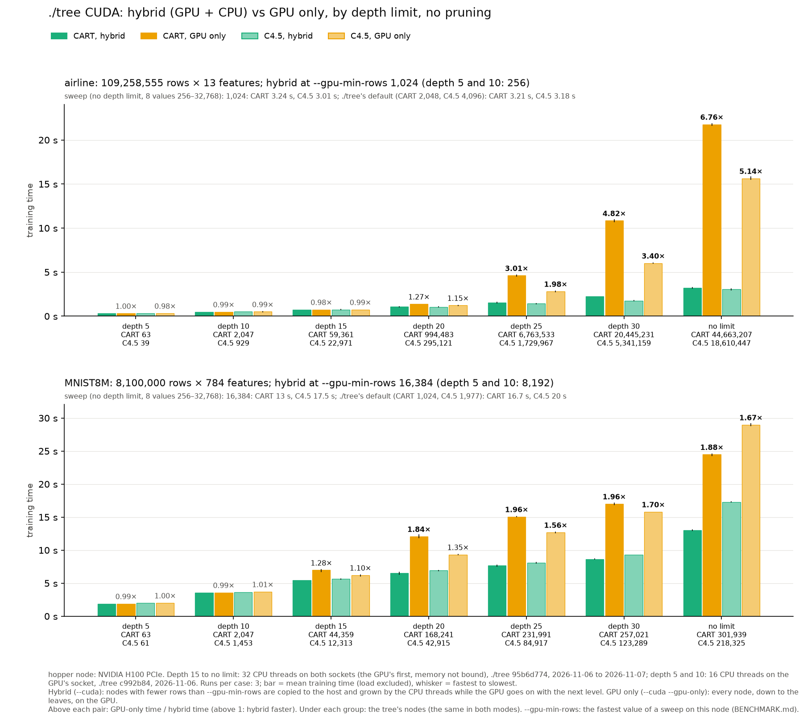

# hybrid-vs-gpu-only: ./tree's CUDA hybrid against GPU only, by depth




**What.** ./tree `--cuda` (hybrid: a node with fewer rows than
`--gpu-min-rows` is copied to the host and its subtree grown by the CPU
threads while the GPU goes on with the next level) against `--cuda --gpu-only`
(every node, down to the leaves, on the GPU). CART and C4.5 without pruning,
grown to depth 5, 10, 15, 20, 25, 30 and without a depth limit, on two
datasets: airline (109.3M rows × 13 features), where the gap is the largest of
the datasets tried, and MNIST8M (8.1M × 784), where it is the smallest that
both algorithms agree on. 3 runs a case. The trees are the same in both modes
(node counts under each group).

**Where.** The whole node (`--exclusive`), one GPU, every CPU of the node:
ampere, A100 80 GB PCIe (GPU 0, NUMA node 0), 48 threads (CPUs 0–23, then
24–47); hopper, H100 PCIe (GPU 2, NUMA node 1), 32 threads (16–31, then 0–15).
The GPU's socket's CPUs come first and the memory is not bound
([bench/cluster/README.md](../../cluster/README.md#settings-specific-to-the-cluster)).
Depth 15 to no limit, and the `--gpu-min-rows` sweep: ./tree 95b6d77
(sm_80 and sm_90), 2026-11-06/07, jobs 174 (ampere) and 175 (hopper).

Depth 5 and 10 are from the first runs of this benchmark, on the GPU's socket
only (ampere 24 threads with `numactl --membind=0`, ./tree fef9ac0,
2026-11-03; hopper 16 threads with `--membind 1`, `src/` of fef9ac0,
2026-11-06, job 60), at the `--gpu-min-rows` of that sweep (airline 512,
MNIST8M 8,192); their run folders keep that job's `machine-depth5-10.json`,
`plan-depth5-10.json` and `run-depth5-10.log`. They were not rerun: at depth
10 and below the hybrid hands almost nothing to the CPU, and a test on ampere
(HIGGS, SUSY, airline, MNIST8M) found both sockets within ±6% of one there.
The one-socket runs of depth 15 and deeper are in git (7b5a8d4).

## Results (ampere)

Mean training time of 3 runs (presort, build; not reading the data); the
spread is at most 5% in every case. Hybrid / GPU only, GPU only / hybrid in
brackets.

| Depth | airline CART | airline C4.5 | MNIST8M CART | MNIST8M C4.5 |
|---|---|---|---|---|
| 5 | 0.55 / 0.55 s (1.00×) | 0.56 / 0.55 s (0.98×) | 3.26 / 3.22 s (0.99×) | 3.33 / 3.30 s (0.99×) |
| 10 | 0.80 / 0.80 s (0.99×) | 0.82 / 0.81 s (0.99×) | 5.47 / 5.34 s (0.98×) | 5.40 / 5.53 s (1.02×) |
| 15 | 1.09 / 1.07 s (0.99×) | 1.09 / 1.11 s (1.02×) | 7.47 / 8.82 s (1.18×) | 7.49 / 7.98 s (1.07×) |
| 20 | 1.52 / 1.80 s (1.18×) | 1.45 / 1.68 s (1.16×) | 8.75 / 14.8 s (1.69×) | 9.17 / 11.6 s (1.27×) |
| 25 | 1.98 / 4.91 s (2.48×) | 1.91 / 3.33 s (1.74×) | 9.86 / 18.5 s (1.87×) | 10.6 / 15.6 s (1.48×) |
| 30 | 2.49 / 12.2 s (4.92×) | 2.19 / 6.84 s (3.12×) | 11.0 / 20.5 s (1.86×) | 12.0 / 19.2 s (1.60×) |
| none | 3.31 / 25.4 s (7.69×) | 3.20 / 18.9 s (5.89×) | 17.0 / 29.6 s (1.75×) | 22.1 / 35.0 s (1.58×) |

- **Up to depth 15 the modes are equal** (0.98–1.02×, MNIST8M's depth 15 aside):
  few nodes get below `--gpu-min-rows`, so the hybrid hands almost nothing to
  the CPU, and both run the same GPU levels.
- **Deeper, the hybrid wins, and by how much depends on how many small nodes
  the tree has.** airline's unlimited CART tree has 44.7M nodes, nearly all
  of them small: GPU only still pays a whole level's kernels and
  synchronisation for every level of nodes of a few rows, where the hybrid's
  CPU threads grow those subtrees in one go. MNIST8M's trees have 0.2–0.3M
  nodes, so the GPU-only tail is short and the gap stays at about 1.6–1.9×
  from depth 20 on (CART).
- **The gap is all in the build.** GPU setup is the same in both modes
  (airline 0.31–0.33 s, MNIST8M 1.2 s at no depth limit). Build at no depth
  limit: airline CART 2.98 s hybrid, 25.1 s GPU only; MNIST8M CART 15.7 s,
  28.4 s.

## Results (hopper)

Mean training time of 3 runs, as for ampere; the spread is at most 6%.
Hybrid / GPU only, GPU only / hybrid in brackets.

| Depth | airline CART | airline C4.5 | MNIST8M CART | MNIST8M C4.5 |
|---|---|---|---|---|
| 5 | 0.32 / 0.32 s (1.00×) | 0.33 / 0.32 s (0.98×) | 1.90 / 1.89 s (0.99×) | 2.01 / 2.00 s (1.00×) |
| 10 | 0.50 / 0.49 s (0.99×) | 0.51 / 0.51 s (0.99×) | 3.58 / 3.56 s (0.99×) | 3.66 / 3.71 s (1.01×) |
| 15 | 0.75 / 0.74 s (0.98×) | 0.75 / 0.75 s (0.99×) | 5.47 / 6.98 s (1.28×) | 5.65 / 6.21 s (1.10×) |
| 20 | 1.08 / 1.38 s (1.27×) | 1.06 / 1.22 s (1.15×) | 6.56 / 12.1 s (1.84×) | 6.91 / 9.34 s (1.35×) |
| 25 | 1.53 / 4.61 s (3.01×) | 1.42 / 2.82 s (1.98×) | 7.67 / 15.1 s (1.96×) | 8.12 / 12.7 s (1.56×) |
| 30 | 2.25 / 10.8 s (4.82×) | 1.77 / 6.02 s (3.40×) | 8.66 / 17.0 s (1.96×) | 9.29 / 15.8 s (1.70×) |
| none | 3.22 / 21.8 s (6.76×) | 3.04 / 15.6 s (5.14×) | 13.0 / 24.5 s (1.88×) | 17.3 / 29.0 s (1.67×) |

The trees are the same as ampere's (node counts in both charts).

**hopper against ampere.**
- **The same picture:** equal to depth 15 on airline (0.98–1.02×) and to
  depth 10 on MNIST8M, then the hybrid wins by about as much as on ampere
  (airline 4.8× / 3.4× at depth 30, MNIST8M 1.6–2.0× from depth 25).
- **The H100 does not widen the gap.** Where the GPU does all the work
  (depth ≤ 15) the H100 is 1.4–1.7× the A100 (airline depth 5 0.32 s against
  0.55 s; MNIST8M 1.90 s against 3.26 s). GPU only at no limit gains less,
  1.2× (airline CART 21.8 s against 25.4 s), as its long tail of levels of a
  few nodes is launch and synchronisation bound.
- **The hybrid at no limit on airline is CPU bound:** 3.22 s against ampere's
  3.31 s (C4.5 3.04 s against 3.20 s), with 32 threads against 48. On
  MNIST8M the H100 also speeds up the hybrid (13.0 s against 17.0 s, 1.31×).

## Both sockets against one

Until 2026-11-06 every CUDA run of the cluster had only the CPUs and memory
of the GPU's socket (ampere 24 threads, hopper 16). Depth 15 and deeper were
then run again on both sockets; the hybrid's time, one socket / both (above
1: both faster), with each placement's own swept `--gpu-min-rows`:

| Depth | ampere airline CART | C4.5 | ampere MNIST8M CART | C4.5 | hopper airline CART | C4.5 | hopper MNIST8M CART | C4.5 |
|---|--:|--:|--:|--:|--:|--:|--:|--:|
| 15 | 1.00 | 1.02 | 1.05 | 1.03 | 0.92 | 0.96 | 1.04 | 0.95 |
| 20 | 1.03 | 1.03 | 1.13 | 1.06 | 1.09 | 1.01 | 1.18 | 1.00 |
| 25 | 1.08 | 1.05 | 1.18 | 1.08 | 1.27 | 1.17 | 1.22 | 1.04 |
| 30 | 1.30 | 1.15 | 1.14 | 1.07 | 1.28 | 1.31 | 1.21 | 1.04 |
| none | 1.36 | 1.30 | 1.11 | 1.06 | 1.37 | 1.29 | 1.12 | 1.04 |

- **The second socket pays off where the CPU grows many subtrees:** airline
  from depth 25 (1.15–1.37×, the CPU-bound tail of millions of small nodes),
  MNIST8M CART from depth 20 (1.11–1.22×). MNIST8M's C4.5 gains 0–8%.
- **GPU only barely changes** (ampere 0.97–1.03×, hopper 0.94–1.02×), so the
  hybrid's lead over it grows: airline CART at no limit 5.5× → 7.7× on
  ampere, 5.0× → 6.8× on hopper.
- **hopper at depth 15 is 4–8% slower**, but GPU only is too (0.94–0.97×):
  the GPU does nearly all the work there, so this is the newer build or the
  node, not the CPU threads.
- **The sweep moves up:** with more threads the CPU takes bigger nodes well,
  so the best `--gpu-min-rows` doubles (airline 512 → 2,048 on ampere, 256 →
  1,024 on hopper; MNIST8M 8,192 → 16,384 on both). The ratios above mix the
  placement with that retuning; at a fixed value the gain is about the same
  (ampere airline CART at no limit, `--gpu-min-rows 512`: 4.48 s one socket,
  3.55 s both, 1.26×).
- A test before these runs (ampere, HIGGS, SUSY, airline and MNIST8M, 3 runs,
  not kept) also tried both sockets' CPUs with the memory bound to the GPU's
  node: slower than not binding it in every deep case.

## Who is working (MNIST8M, ampere, profiled)


The MNIST8M depth runs once more with `./tree --profile`, 3 runs a case
(`profile/{cuda,gpuonly}-ampere-mnist8m/`): depth 15 to no limit in the same
job as the plain runs (174, 48 threads on both sockets, `--gpu-min-rows
16384`, 2026-11-07), depth 5 and 10 from the first, one-socket runs (c992b84,
24 threads, `--gpu-min-rows 8192`, 2026-11-04, jobs 87 and 88). Profiling
costs little here: every profiled mean is within 2.2% of the plain run's.

Each millisecond of training goes to one segment
([hybrid_profile_chart.py](../../hybrid_profile_chart.py)):
- **Setup:** before growing: GPU context and memory, upload, presort.
- **GPU alone:** a GPU kernel runs and no CPU thread grows a subtree.
- **GPU + CPU at once:** a kernel runs while CPU threads grow subtrees (hybrid only).
- **CPU alone:** no kernel or copy runs, CPU threads grow subtrees.
- **Transfer:** a host↔GPU copy runs with no kernel, or the host stages copies.
- **Host:** none of these: launching kernels, waiting, assembling the tree, C4.5's tidy-up.

CPU subtree work is the threads sampled (every 5 ms) in sweep, partition,
mark, build or leaves; under each bar its thread-seconds.

- **Setup is the same 1.19–1.29 s in both modes**, 38–39% of a depth-5 tree, 4–7% at no limit.
- **The CPU's subtree work grows with depth**, CART 0 → 4 → 104 → 190 → 255 → 307 → 445
  thread-seconds (depth 5 → no limit), C4.5 0 → 2 → 31 → 89 → 156 → 217 → 409;
  at no limit that is 19–28 of the 48 threads busy on average while growing.
- **It almost all runs alongside the GPU:** the GPU + CPU segment grows from 0
  to 66% (CART) and 75% (C4.5) of the hybrid's time; CPU alone, the GPU
  waiting for it or for the host between levels, stays at 0–1.4 s (most at
  C4.5 no limit, 6%, and CART depth 30, 5%). On one socket it reached 12% at
  CART depth 25–30: the second socket's threads take most of that wait away.
- **GPU only does that work on the GPU instead**: its GPU segment grows from
  1.9 s to 24.7 s (CART) and 29.9 s (C4.5), against the hybrid's 13.9 s
  and 18.6 s of GPU time (alone + with CPU). Its host time (launching and
  synchronising many short levels) grows to 2.5–3 s, 5–10% from depth 20 on,
  where the hybrid's is under 0.1 s.
- **The hybrid pays 0.5–1.6 s of transfer** (the small nodes' columns copied to the
  host) from depth 15 on, against 0.08–1.12 s for GPU only. It is larger
  than on one socket (0.3–1 s), probably because at the larger
  `--gpu-min-rows` more nodes go to the CPU.
- Up to depth 10 the two modes' bars are the same, as are their times.

The hybrid alone, in seconds on a linear axis shared by both panels, and as
shares of each bar:


Table (seconds, share of the training time in brackets; `hybrid_profile_chart.py` prints it):

bench/results/hybrid-vs-gpu-only/chart-profile-ampere-mnist8m.png
| Algorithm | Depth | Mode | runs | train s | without --profile s | nodes | Setup (GPU init, upload, presort) s (%) | GPU working alone s (%) | GPU + CPU working at once s (%) | CPU working alone s (%) | CPU↔GPU transfer s (%) | Host: launching, waiting, finishing s (%) | CPU subtree thr·s |
|---|---|---|--:|--:|--:|--:|--:|--:|--:|--:|--:|--:|--:|
| CART | 5 | hybrid | 3 | 3.20 | 3.26 | 63 | 1.25 (39) | 1.90 (59) | 0.00 (0) | 0.00 (0) | 0.03 (1) | 0.02 (1) | 0 |
| CART | 5 | GPU only | 3 | 3.25 | 3.22 | 63 | 1.28 (39) | 1.94 (60) | 0.00 (0) | 0.00 (0) | 0.01 (0) | 0.03 (1) | 0 |
| CART | 10 | hybrid | 3 | 5.49 | 5.47 | 2,047 | 1.26 (23) | 3.70 (67) | 0.23 (4) | 0.00 (0) | 0.27 (5) | 0.03 (1) | 4 |
| CART | 10 | GPU only | 3 | 5.35 | 5.34 | 2,047 | 1.27 (24) | 4.02 (75) | 0.00 (0) | 0.00 (0) | 0.02 (0) | 0.05 (1) | 0 |
| CART | 15 | hybrid | 3 | 7.55 | 7.47 | 44,359 | 1.25 (17) | 2.80 (37) | 2.14 (28) | 0.09 (1) | 1.25 (17) | 0.03 (0) | 104 |
| CART | 15 | GPU only | 3 | 8.78 | 8.82 | 44,359 | 1.20 (14) | 7.01 (80) | 0.00 (0) | 0.00 (0) | 0.18 (2) | 0.40 (5) | 0 |
| CART | 20 | hybrid | 3 | 8.80 | 8.75 | 168,241 | 1.25 (14) | 2.59 (29) | 3.37 (38) | 0.17 (2) | 1.40 (16) | 0.04 (0) | 190 |
| CART | 20 | GPU only | 3 | 14.74 | 14.78 | 168,241 | 1.26 (9) | 11.51 (78) | 0.00 (0) | 0.00 (0) | 0.60 (4) | 1.37 (9) | 0 |
| CART | 25 | hybrid | 3 | 9.88 | 9.86 | 231,991 | 1.22 (12) | 2.39 (24) | 4.51 (46) | 0.29 (3) | 1.44 (15) | 0.03 (0) | 255 |
| CART | 25 | GPU only | 3 | 18.41 | 18.45 | 231,991 | 1.20 (7) | 14.40 (78) | 0.00 (0) | 0.00 (0) | 0.89 (5) | 1.92 (10) | 0 |
| CART | 30 | hybrid | 3 | 11.00 | 11.02 | 257,021 | 1.21 (11) | 2.39 (22) | 5.40 (49) | 0.50 (5) | 1.48 (13) | 0.03 (0) | 307 |
| CART | 30 | GPU only | 3 | 20.56 | 20.45 | 257,021 | 1.25 (6) | 16.31 (79) | 0.00 (0) | 0.00 (0) | 0.93 (5) | 2.07 (10) | 0 |
| CART | none | hybrid | 3 | 17.03 | 16.95 | 301,939 | 1.26 (7) | 2.65 (16) | 11.22 (66) | 0.28 (2) | 1.58 (9) | 0.05 (0) | 445 |
| CART | none | GPU only | 3 | 29.57 | 29.63 | 301,939 | 1.28 (4) | 24.71 (84) | 0.00 (0) | 0.00 (0) | 1.07 (4) | 2.52 (9) | 0 |
| C4.5 | 5 | hybrid | 3 | 3.38 | 3.33 | 61 | 1.28 (38) | 2.01 (59) | 0.01 (0) | 0.00 (0) | 0.05 (1) | 0.03 (1) | 0 |
| C4.5 | 5 | GPU only | 3 | 3.33 | 3.30 | 61 | 1.27 (38) | 2.02 (61) | 0.00 (0) | 0.00 (0) | 0.01 (0) | 0.03 (1) | 0 |
| C4.5 | 10 | hybrid | 3 | 5.52 | 5.40 | 1,453 | 1.27 (23) | 3.78 (68) | 0.38 (7) | 0.00 (0) | 0.06 (1) | 0.04 (1) | 2 |
| C4.5 | 10 | GPU only | 3 | 5.57 | 5.53 | 1,453 | 1.29 (23) | 4.22 (76) | 0.00 (0) | 0.00 (0) | 0.02 (0) | 0.05 (1) | 0 |
| C4.5 | 15 | hybrid | 3 | 7.50 | 7.49 | 12,313 | 1.21 (16) | 3.40 (45) | 2.37 (32) | 0.01 (0) | 0.48 (6) | 0.04 (1) | 31 |
| C4.5 | 15 | GPU only | 3 | 8.03 | 7.98 | 12,313 | 1.23 (15) | 6.52 (81) | 0.00 (0) | 0.00 (0) | 0.08 (1) | 0.20 (3) | 0 |
| C4.5 | 20 | hybrid | 3 | 9.19 | 9.17 | 42,915 | 1.21 (13) | 2.58 (28) | 4.63 (50) | 0.02 (0) | 0.70 (8) | 0.04 (0) | 89 |
| C4.5 | 20 | GPU only | 3 | 11.62 | 11.62 | 42,915 | 1.19 (10) | 9.57 (82) | 0.00 (0) | 0.00 (0) | 0.26 (2) | 0.60 (5) | 0 |
| C4.5 | 25 | hybrid | 3 | 10.62 | 10.58 | 84,917 | 1.22 (11) | 2.39 (23) | 6.08 (57) | 0.05 (0) | 0.84 (8) | 0.04 (0) | 156 |
| C4.5 | 25 | GPU only | 3 | 15.60 | 15.64 | 84,917 | 1.24 (8) | 12.80 (82) | 0.00 (0) | 0.00 (0) | 0.42 (3) | 1.15 (7) | 0 |
| C4.5 | 30 | hybrid | 3 | 11.96 | 11.97 | 123,289 | 1.19 (10) | 2.20 (18) | 7.40 (62) | 0.15 (1) | 0.96 (8) | 0.05 (0) | 217 |
| C4.5 | 30 | GPU only | 3 | 19.19 | 19.19 | 123,289 | 1.22 (6) | 15.72 (82) | 0.00 (0) | 0.00 (0) | 0.59 (3) | 1.67 (9) | 0 |
| C4.5 | none | hybrid | 3 | 22.42 | 22.11 | 218,325 | 1.23 (5) | 1.78 (8) | 16.84 (75) | 1.39 (6) | 1.12 (5) | 0.07 (0) | 409 |
| C4.5 | none | GPU only | 3 | 35.24 | 35.03 | 218,325 | 1.24 (4) | 29.88 (85) | 0.00 (0) | 0.00 (0) | 1.12 (3) | 3.00 (9) | 0 |

## --gpu-min-rows: the sweep

Before the depth runs, each job runs the hybrid at no depth limit, CART and
C4.5, at ./tree's default (CART rows/8192 clamped to 1,024–2,048, C4.5
rows/4096 clamped to 1,024–4,096) and at fixed values, 3 runs a value, not
interleaved (`hybrid_vs_gpu_only.sh`). The value taken has the smallest mean,
over CART and C4.5, of its time over that algorithm's fastest. Results:
`sweep/cuda-<node>-<dataset>-mr<value>/`, summary `sweep/<node>-<dataset>.json`.

ampere (48 threads):

| airline | default | 256 | 512 | 1024 | **2048** | 4096 | 8192 | 16384 | 32768 |
|---|---|---|---|---|---|---|---|---|---|
| CART (s) | 3.37 | 7.37 | 3.55 | 3.39 | **3.32** | 3.43 | 3.60 | 3.86 | 4.32 |
| C4.5 (s) | 3.21 | 6.52 | 3.96 | 3.23 | **3.17** | 3.23 | 3.48 | 3.86 | 4.41 |

| MNIST8M | default | 256 | 512 | 1024 | 2048 | 4096 | 8192 | **16384** | 32768 |
|---|---|---|---|---|---|---|---|---|---|
| CART (s) | 21.0 | 23.2 | 22.1 | 21.1 | 20.1 | 19.4 | 18.3 | **17.0** | 20.4 |
| C4.5 (s) | 24.8 | 29.0 | 27.3 | 26.0 | 24.8 | 23.7 | 22.5 | **22.2** | 21.0 |

hopper (32 threads):

| airline | default | 256 | 512 | **1024** | 2048 | 4096 | 8192 | 16384 | 32768 |
|---|---|---|---|---|---|---|---|---|---|
| CART (s) | 3.21 | 4.01 | 3.28 | **3.24** | 3.23 | 3.38 | 3.48 | 3.90 | 4.13 |
| C4.5 (s) | 3.18 | 3.97 | 3.06 | **3.01** | 3.12 | 3.24 | 3.47 | 3.83 | 4.50 |

| MNIST8M | default | 256 | 512 | 1024 | 2048 | 4096 | 8192 | **16384** | 32768 |
|---|---|---|---|---|---|---|---|---|---|
| CART (s) | 16.7 | 19.0 | 17.6 | 16.8 | 16.1 | 15.4 | 14.3 | **13.0** | 16.0 |
| C4.5 (s) | 20.0 | 23.7 | 22.4 | 21.0 | 20.1 | 18.9 | 18.0 | **17.5** | 16.1 |

- **airline's minimum is flat**, and ./tree's default (2,048 / 4,096) is within
  1–3% of the tuned value on both nodes; below 512 airline slows down sharply
  (2.1× at 256 on ampere).
- **MNIST8M takes 16,384 on both nodes**, CART 24–28% and C4.5 12–14%
  faster than the default (1,024 / 1,977). C4.5 alone would take 32,768 (6–9%
  faster than 16,384), where CART is 20–23% slower.
- **Against one socket the best value doubles** (below): with twice the
  threads the CPU keeps up with bigger nodes.

The first, one-socket sweeps (the values of the depth 5 and 10 runs) are in
`sweep-one-socket/`: ampere by hand through `tune.sh`, interleaved
(`numactl --membind=0 taskset -c 0-23`, `--threads 24`; `ampere-*.csv`,
`ampere-<dataset>.json`), hopper by `hybrid_vs_gpu_only.sh` (job 60,
`cuda-hopper-*` and `hopper-<dataset>.json`). They took airline 512 (ampere)
and 256 (hopper), MNIST8M 8,192 on both:

| one socket | default | 256 | 512 | 1024 | 2048 | 4096 | 8192 | 16384 | 32768 |
|---|---|---|---|---|---|---|---|---|---|
| ampere airline CART (s) | 4.60 | 4.58 | **4.48** | 4.50 | 4.59 | 4.76 | 5.11 | 5.58 | 6.06 |
| ampere airline C4.5 (s) | 4.51 | 4.40 | **4.16** | 4.16 | 4.28 | 4.51 | 4.90 | 5.49 | 6.15 |
| ampere MNIST8M CART (s) | 21.4 | – | 22.3 | 21.2 | 20.5 | 20.0 | **19.0** | 20.5 | 27.0 |
| ampere MNIST8M C4.5 (s) | 25.3 | – | 27.7 | 26.3 | 25.5 | 24.2 | **23.4** | 22.7 | 26.9 |
| hopper airline CART (s) | 4.62 | **4.39** | 4.46 | 4.49 | 4.64 | 4.79 | 5.01 | 5.43 | 5.94 |
| hopper airline C4.5 (s) | 4.46 | **3.94** | 3.90 | 4.01 | 4.19 | 4.47 | 4.89 | 5.34 | 6.09 |
| hopper MNIST8M CART (s) | 16.6 | 18.7 | 17.4 | 16.6 | 16.0 | 15.5 | **14.5** | 17.0 | 23.7 |
| hopper MNIST8M C4.5 (s) | 19.6 | 23.5 | 22.1 | 20.6 | 19.6 | 18.9 | **17.9** | 17.7 | 23.2 |

**Datasets.** Picked from a screen at no depth limit on one socket of ampere,
one run each (`sweep-one-socket/ampere-screen.csv`), GPU only / hybrid, CART
and C4.5: airline 5.4× / 4.1×, HIGGS 3.0× / 2.8×, SUSY 3.0× / 1.1×, ECBDL'14
15M 1.5× / 1.3×, MNIST8M 1.44× / 1.40×, Covertype too short to count (0.1 s).

## Commands

Depth 15 to no limit and the sweep, one job per node: a wrapper (not kept)
built ./tree 95b6d77 for sm_80 and sm_90 inside the job, then ran
`bench/cluster/hybrid_vs_gpu_only.sh` with the deep protocols into
`hybrid-vs-gpu-only/both-sockets/`, merged here afterwards (the depth 5 and
10 rows kept, the deeper one-socket rows replaced). Without the wrapper, from
the repository root after `bench/cluster/build.sh`:

```bash
P=cart_depth15,cart_depth20,cart_depth25,cart_depth30,cart_full_nodepth,c45_depth15_unpruned,c45_depth20_unpruned,c45_depth25_unpruned,c45_depth30_unpruned,c45_unpruned
sbatch -J dt-hvg -p ampere -w ampere --exclusive -t 14:00:00 -o bench/results/hybrid-vs-gpu-only/ampere-both-sockets.log \
    --export=ALL,TREE_GIT_DESCRIBE="$(git describe --always --dirty)",PROTOCOLS=$P,PROFILE_DATASETS=mnist8m \
    bench/cluster/hybrid_vs_gpu_only.sh ampere
sbatch -J dt-hvg -p hopper -w hopper --exclusive -t 10:00:00 -o bench/results/hybrid-vs-gpu-only/hopper-both-sockets.log \
    --export=ALL,TREE_GIT_DESCRIBE="$(git describe --always --dirty)",PROTOCOLS=$P,PROFILE_DATASETS= \
    bench/cluster/hybrid_vs_gpu_only.sh hopper
```

(job.sh gives the CUDA runs every CPU of the node since 95b6d77; the first
runs, with the GPU's socket only, were ampere by hand through `tune.sh` and
job.sh, and hopper as job 60, `hopper-one-socket.log`.)

Charts (`--node hopper` for hopper's) and the profile charts and table:

```bash
d=bench/results/hybrid-vs-gpu-only
bench/.venv/bin/python bench/hybrid_chart.py $d --node ampere --datasets airline,mnist8m
bench/.venv/bin/python bench/hybrid_profile_chart.py $d --node ampere --dataset mnist8m
bench/.venv/bin/python bench/hybrid_profile_chart.py $d --node ampere --dataset mnist8m --hybrid-only --seconds
bench/.venv/bin/python bench/hybrid_profile_chart.py $d --node ampere --dataset mnist8m --hybrid-only
```
