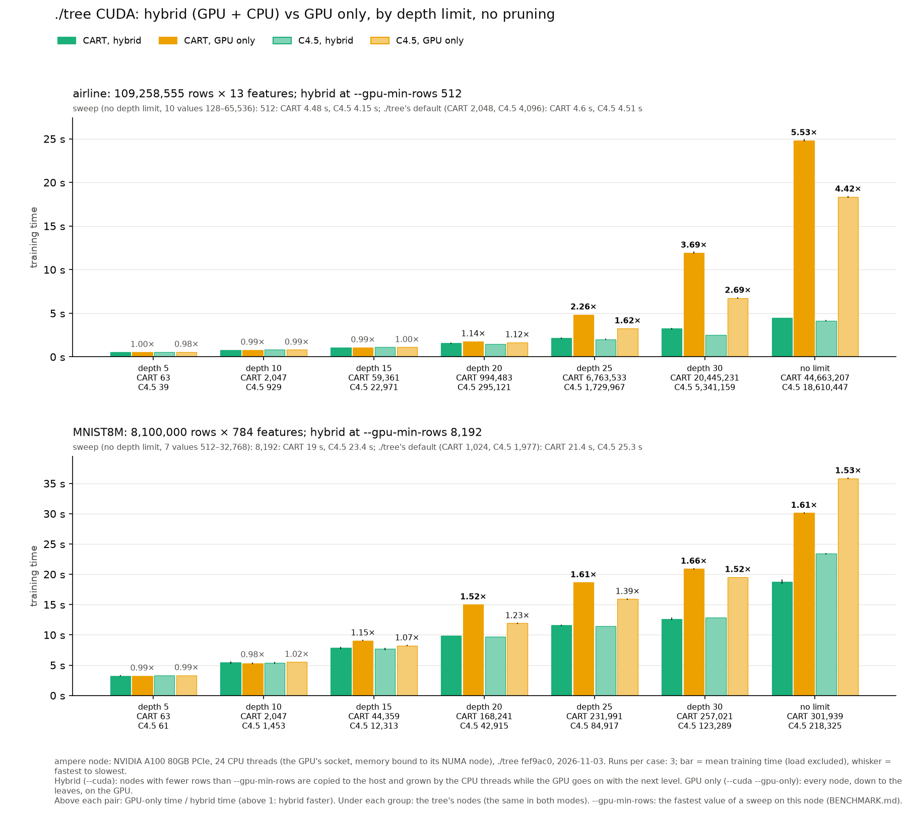
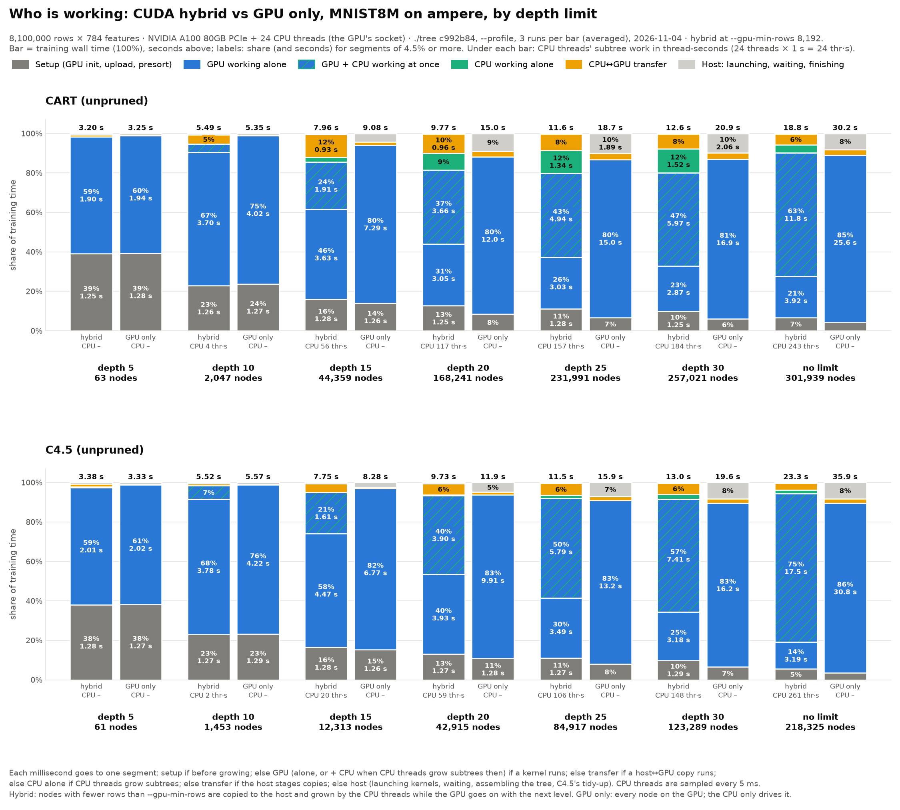
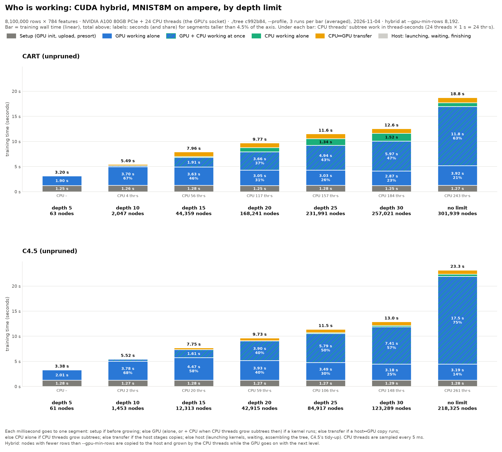
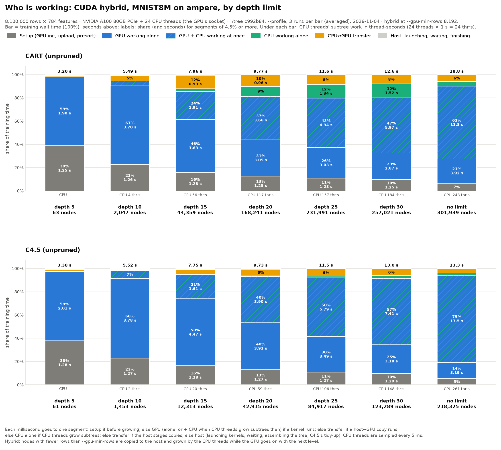

# hybrid-vs-gpu-only: ./tree's CUDA hybrid against GPU only, by depth



hopper: queued (job in `hopper.log`), chart `chart-hopper.png` once it ran.

**What.** ./tree `--cuda` (hybrid: a node with fewer rows than
`--gpu-min-rows` is copied to the host and its subtree grown by the CPU
threads while the GPU goes on with the next level) against `--cuda --gpu-only`
(every node, down to the leaves, on the GPU). CART and C4.5 without pruning,
grown to depth 5, 10, 15, 20, 25, 30 and without a depth limit, on two
datasets: airline (109.3M rows × 13 features), where the gap is the largest of
the datasets tried, and MNIST8M (8.1M × 784), where it is the smallest that
both algorithms agree on. 3 runs a case. The trees are the same in both modes
(node counts under each group).

**Where.** ampere: A100 80 GB PCIe (GPU 0), the 24 CPUs of its socket and
`numactl --membind=0` (job.sh's choice: the GPU's NUMA node), the whole node
(`--exclusive`). ./tree fef9ac0, 2026-11-03.

## Results (ampere)

Mean training time of 3 runs (presort, build; not reading the data); the
spread is under 3% in every case. GPU only / hybrid in brackets.

| Depth | airline CART | airline C4.5 | MNIST8M CART | MNIST8M C4.5 |
|---|---|---|---|---|
| 5 | 0.55 s / 0.55 s (1.00×) | 0.56 / 0.55 s (0.98×) | 3.26 / 3.22 s (0.99×) | 3.33 / 3.30 s (0.99×) |
| 10 | 0.80 / 0.80 s (0.99×) | 0.82 / 0.81 s (0.99×) | 5.47 / 5.34 s (0.98×) | 5.41 / 5.53 s (1.02×) |
| 15 | 1.08 / 1.08 s (0.99×) | 1.11 / 1.11 s (1.00×) | 7.86 / 9.07 s (1.15×) | 7.73 / 8.25 s (1.07×) |
| 20 | 1.56 / 1.78 s (1.14×) | 1.49 / 1.67 s (1.12×) | 9.86 / 15.0 s (1.52×) | 9.72 / 11.9 s (1.23×) |
| 25 | 2.14 / 4.85 s (2.26×) | 2.01 / 3.26 s (1.62×) | 11.6 / 18.7 s (1.61×) | 11.4 / 15.9 s (1.39×) |
| 30 | 3.23 / 11.9 s (3.69×) | 2.51 / 6.75 s (2.69×) | 12.6 / 20.9 s (1.66×) | 12.9 / 19.5 s (1.52×) |
| none | 4.49 / 24.8 s (5.53×) | 4.15 / 18.4 s (4.42×) | 18.8 / 30.1 s (1.61×) | 23.4 / 35.8 s (1.53×) |

Times are hybrid / GPU only.

- **Up to depth 15 the modes are equal** (0.98–1.02×, MNIST8M's depth 15 aside):
  few nodes get below `--gpu-min-rows`, so the hybrid hands almost nothing to
  the CPU, and both run the same GPU levels.
- **Deeper, the hybrid wins, and by how much depends on how many small nodes
  the tree has.** airline's unlimited CART tree has 44.7M nodes, nearly all
  of them small: GPU only still pays a whole level's kernels and
  synchronisation for every level of nodes of a few rows, where the hybrid's
  CPU threads grow those subtrees in one go. MNIST8M's trees have 0.2–0.3M
  nodes, so the GPU-only tail is short and the gap stays at about 1.5–1.7×
  from depth 20 on.
- **The gap is all in the build.** GPU setup is the same in both modes
  (airline 0.32–0.33 s, MNIST8M 1.26–1.28 s at no depth limit): neither
  dataset has many distinct values for C4.5's presort, so the hybrid's
  background zeroing of its host arena costs nothing here (unlike sorel_4m's
  C4.5). Build at no depth limit: airline CART 4.17 s hybrid, 24.5 s GPU
  only; MNIST8M CART 17.5 s, 28.9 s.

## Who is working (MNIST8M, ampere, profiled)



The MNIST8M depth runs once more with `./tree --profile`, same build
(c992b84), node, GPU and `--gpu-min-rows 8192`, 3 runs a case, 2026-11-04
(`profile/{cuda,gpuonly}-ampere-mnist8m/`, jobs 87 and 88). Profiling costs
nothing measurable here: every profiled mean is within 2% of the plain run's.

Each millisecond of training goes to one segment
([hybrid_profile_chart.py](../../hybrid_profile_chart.py)):
- **Setup:** before growing: GPU context and memory, upload, presort.
- **GPU alone:** a GPU kernel runs and no CPU thread grows a subtree.
- **GPU + CPU at once:** a kernel runs while CPU threads grow subtrees (hybrid only).
- **CPU alone:** no kernel or copy runs, CPU threads grow subtrees.
- **Transfer:** a host↔GPU copy runs with no kernel, or the host stages copies.
- **Host:** none of these: launching kernels, waiting, assembling the tree, C4.5's tidy-up.

CPU subtree work is the threads sampled (every 5 ms) in sweep, partition,
mark, build or leaves; under each bar its thread-seconds.

- **Setup is the same 1.25–1.29 s in both modes**, 38% of a depth-5 tree, 4–7% at no limit.
- **The CPU's subtree work grows with depth**, CART 0 → 4 → 56 → 117 → 157 → 184 → 243
  thread-seconds (depth 5 → no limit), C4.5 0 → 2 → 20 → 59 → 106 → 148 → 261;
  at no limit that is 12–14 of the 24 threads busy on average while growing.
- **It almost all runs alongside the GPU:** the GPU + CPU segment grows from 0
  to 63% (CART) and 75% (C4.5) of the hybrid's time; CPU alone, the GPU
  waiting for it or for the host between levels, stays at 0–1.5 s (most at
  CART depth 20–30, ~12%).
- **GPU only does that work on the GPU instead**: its GPU segment grows from
  1.9 s to 25.6 s (CART) and 30.8 s (C4.5), against the hybrid's 15.7 s
  and 20.7 s of GPU time (alone + with CPU). Its host time (launching and
  synchronising many short levels) grows to 2–3 s, 8–10% from depth 20 on,
  where the hybrid's is under 0.1 s.
- **The hybrid pays 0.3–1 s of transfer** (the small nodes' columns copied to the
  host) from depth 15 on, against 0.06–0.84 s for GPU only.
- Up to depth 10 the two modes' bars are the same, as are their times.

The hybrid alone, in seconds on a linear axis shared by both panels, and as
shares of each bar:





Table (seconds, share of the training time in brackets; `hybrid_profile_chart.py` prints it):

| Algorithm | Depth | Mode | runs | train s | without --profile s | nodes | Setup (GPU init, upload, presort) s (%) | GPU working alone s (%) | GPU + CPU working at once s (%) | CPU working alone s (%) | CPU↔GPU transfer s (%) | Host: launching, waiting, finishing s (%) | CPU subtree thr·s |
|---|---|---|--:|--:|--:|--:|--:|--:|--:|--:|--:|--:|--:|
| CART | 5 | hybrid | 3 | 3.20 | 3.26 | 63 | 1.25 (39) | 1.90 (59) | 0.00 (0) | 0.00 (0) | 0.03 (1) | 0.02 (1) | 0 |
| CART | 5 | GPU only | 3 | 3.25 | 3.22 | 63 | 1.28 (39) | 1.94 (60) | 0.00 (0) | 0.00 (0) | 0.01 (0) | 0.03 (1) | 0 |
| CART | 10 | hybrid | 3 | 5.49 | 5.47 | 2,047 | 1.26 (23) | 3.70 (67) | 0.23 (4) | 0.00 (0) | 0.27 (5) | 0.03 (1) | 4 |
| CART | 10 | GPU only | 3 | 5.35 | 5.34 | 2,047 | 1.27 (24) | 4.02 (75) | 0.00 (0) | 0.00 (0) | 0.02 (0) | 0.05 (1) | 0 |
| CART | 15 | hybrid | 3 | 7.96 | 7.86 | 44,359 | 1.28 (16) | 3.63 (46) | 1.91 (24) | 0.18 (2) | 0.93 (12) | 0.03 (0) | 56 |
| CART | 15 | GPU only | 3 | 9.08 | 9.07 | 44,359 | 1.26 (14) | 7.29 (80) | 0.00 (0) | 0.00 (0) | 0.14 (1) | 0.40 (4) | 0 |
| CART | 20 | hybrid | 3 | 9.77 | 9.86 | 168,241 | 1.25 (13) | 3.05 (31) | 3.66 (37) | 0.83 (9) | 0.96 (10) | 0.03 (0) | 117 |
| CART | 20 | GPU only | 3 | 15.05 | 15.02 | 168,241 | 1.27 (8) | 11.99 (80) | 0.00 (0) | 0.00 (0) | 0.44 (3) | 1.35 (9) | 0 |
| CART | 25 | hybrid | 3 | 11.57 | 11.60 | 231,991 | 1.28 (11) | 3.03 (26) | 4.94 (43) | 1.34 (12) | 0.95 (8) | 0.03 (0) | 157 |
| CART | 25 | GPU only | 3 | 18.72 | 18.66 | 231,991 | 1.26 (7) | 14.97 (80) | 0.00 (0) | 0.00 (0) | 0.60 (3) | 1.89 (10) | 0 |
| CART | 30 | hybrid | 3 | 12.61 | 12.61 | 257,021 | 1.25 (10) | 2.87 (23) | 5.97 (47) | 1.52 (12) | 0.96 (8) | 0.03 (0) | 184 |
| CART | 30 | GPU only | 3 | 20.93 | 20.91 | 257,021 | 1.27 (6) | 16.94 (81) | 0.00 (0) | 0.00 (0) | 0.67 (3) | 2.06 (10) | 0 |
| CART | none | hybrid | 3 | 18.83 | 18.75 | 301,939 | 1.27 (7) | 3.92 (21) | 11.78 (63) | 0.76 (4) | 1.04 (6) | 0.06 (0) | 243 |
| CART | none | GPU only | 3 | 30.17 | 30.13 | 301,939 | 1.29 (4) | 25.59 (85) | 0.00 (0) | 0.00 (0) | 0.84 (3) | 2.46 (8) | 0 |
| C4.5 | 5 | hybrid | 3 | 3.38 | 3.33 | 61 | 1.28 (38) | 2.01 (59) | 0.01 (0) | 0.00 (0) | 0.05 (1) | 0.03 (1) | 0 |
| C4.5 | 5 | GPU only | 3 | 3.33 | 3.30 | 61 | 1.27 (38) | 2.02 (61) | 0.00 (0) | 0.00 (0) | 0.01 (0) | 0.03 (1) | 0 |
| C4.5 | 10 | hybrid | 3 | 5.52 | 5.40 | 1,453 | 1.27 (23) | 3.78 (68) | 0.38 (7) | 0.00 (0) | 0.06 (1) | 0.04 (1) | 2 |
| C4.5 | 10 | GPU only | 3 | 5.57 | 5.53 | 1,453 | 1.29 (23) | 4.22 (76) | 0.00 (0) | 0.00 (0) | 0.02 (0) | 0.05 (1) | 0 |
| C4.5 | 15 | hybrid | 3 | 7.75 | 7.73 | 12,313 | 1.28 (16) | 4.47 (58) | 1.61 (21) | 0.00 (0) | 0.34 (4) | 0.05 (1) | 20 |
| C4.5 | 15 | GPU only | 3 | 8.28 | 8.25 | 12,313 | 1.26 (15) | 6.77 (82) | 0.00 (0) | 0.00 (0) | 0.06 (1) | 0.19 (2) | 0 |
| C4.5 | 20 | hybrid | 3 | 9.73 | 9.72 | 42,915 | 1.27 (13) | 3.93 (40) | 3.90 (40) | 0.02 (0) | 0.57 (6) | 0.05 (0) | 59 |
| C4.5 | 20 | GPU only | 3 | 11.93 | 11.91 | 42,915 | 1.28 (11) | 9.91 (83) | 0.00 (0) | 0.00 (0) | 0.16 (1) | 0.58 (5) | 0 |
| C4.5 | 25 | hybrid | 3 | 11.46 | 11.44 | 84,917 | 1.27 (11) | 3.49 (30) | 5.79 (50) | 0.17 (1) | 0.70 (6) | 0.05 (0) | 106 |
| C4.5 | 25 | GPU only | 3 | 15.93 | 15.91 | 84,917 | 1.27 (8) | 13.22 (83) | 0.00 (0) | 0.00 (0) | 0.30 (2) | 1.14 (7) | 0 |
| C4.5 | 30 | hybrid | 3 | 12.95 | 12.86 | 123,289 | 1.29 (10) | 3.18 (25) | 7.41 (57) | 0.30 (2) | 0.74 (6) | 0.05 (0) | 148 |
| C4.5 | 30 | GPU only | 3 | 19.56 | 19.53 | 123,289 | 1.28 (7) | 16.23 (83) | 0.00 (0) | 0.00 (0) | 0.42 (2) | 1.63 (8) | 0 |
| C4.5 | none | hybrid | 3 | 23.26 | 23.39 | 218,325 | 1.28 (5) | 3.19 (14) | 17.46 (75) | 0.44 (2) | 0.82 (4) | 0.08 (0) | 261 |
| C4.5 | none | GPU only | 3 | 35.89 | 35.84 | 218,325 | 1.27 (4) | 30.85 (86) | 0.00 (0) | 0.00 (0) | 0.80 (2) | 2.97 (8) | 0 |

## --gpu-min-rows: the sweep

Before the depth runs, the hybrid at no depth limit, CART and C4.5, at
./tree's default (CART rows/8192 clamped to 1,024–2,048, C4.5 rows/4096
clamped to 1,024–4,096) and at fixed values, interleaved (`tune.sh`), 3 runs a
value. The value taken has the smallest mean, over CART and C4.5, of its time
over that algorithm's fastest. Data: `sweep/ampere-*.csv`, summary
`sweep/ampere-<dataset>.json`.

| airline | default | 128 | 256 | **512** | 1024 | 2048 | 4096 | 8192 | 16384 | 32768 | 65536 |
|---|---|---|---|---|---|---|---|---|---|---|---|
| CART (s) | 4.60 | 5.45 | 4.58 | **4.48** | 4.50 | 4.59 | 4.76 | 5.11 | 5.58 | 6.06 | 7.52 |
| C4.5 (s) | 4.51 | 5.60 | 4.40 | **4.16** | 4.16 | 4.28 | 4.51 | 4.90 | 5.49 | 6.15 | 8.06 |

| MNIST8M | default | 512 | 1024 | 2048 | 4096 | **8192** | 16384 | 32768 |
|---|---|---|---|---|---|---|---|---|
| CART (s) | 21.4 | 22.3 | 21.2 | 20.5 | 20.0 | **19.0** | 20.5 | 27.0 |
| C4.5 (s) | 25.3 | 27.7 | 26.3 | 25.5 | 24.2 | **23.4** | 22.7 | 26.9 |

airline's defaults are 2,048 (CART) and 4,096 (C4.5), MNIST8M's 1,024 and
1,977: the tuned value is 2–8% faster on airline and 7–12% on MNIST8M. With
784 features a node's CPU work is heavier per row, so MNIST8M wants more of
the GPU (8,192); airline, 13 features, the opposite (512).

**Datasets.** Picked from a screen at no depth limit, one run each
(`sweep/ampere-screen.csv`), GPU only / hybrid, CART and C4.5: airline 5.4× /
4.1×, HIGGS 3.0× / 2.8×, SUSY 3.0× / 1.1×, ECBDL'14 15M 1.5× / 1.3×, MNIST8M
1.44× / 1.40×, Covertype too short to count (0.1 s).

## Commands

ampere ran by hand: the screen and sweep through `bench/cluster/tune.sh`
(`numactl --membind=0 taskset -c 0-23`, `--threads 24`), the depth runs as
four jobs through job.sh:

```bash
RUN_EXTRA="--gpu-min-rows 512" bench/cluster/job.sh hybrid-vs-gpu-only cuda-ampere-airline airline tree_cuda 3 <protocols> all 3600
bench/cluster/job.sh hybrid-vs-gpu-only gpuonly-ampere-airline airline tree_gpu_only 3 <protocols> all 3600
```

(and the same for mnist8m at 8192), protocols `cart_depth{5,10,15,20,25,30}`,
`cart_full_nodepth`, `c45_depth{5,10,15,20,25,30}_unpruned`, `c45_unpruned`.

hopper runs the whole of it (sweep with job.sh, value taken, depth runs) as
one job, `bench/cluster/hybrid_vs_gpu_only.sh`:

```bash
sbatch -J dt-hvg-hopper -p hopper -w hopper --exclusive -t 8:00:00 -o bench/results/hybrid-vs-gpu-only/hopper.log \
    --export=ALL,TREE_GIT_DESCRIBE="$(git describe --always --dirty)" bench/cluster/hybrid_vs_gpu_only.sh hopper
```

Chart:

```bash
bench/.venv/bin/python bench/hybrid_chart.py bench/results/hybrid-vs-gpu-only --node ampere --datasets airline,mnist8m
```

The profiled MNIST8M runs on ampere (from `~/dt-hvg`, the same build), and their chart;
`hybrid_vs_gpu_only.sh` now makes these runs itself for the datasets in
`PROFILE_DATASETS` (default `mnist8m`):

```bash
RUN_EXTRA="--gpu-min-rows 8192 --profile" bench/cluster/job.sh hybrid-vs-gpu-only/profile cuda-ampere-mnist8m mnist8m tree_cuda 3 <protocols> all 3600
RUN_EXTRA=--profile bench/cluster/job.sh hybrid-vs-gpu-only/profile gpuonly-ampere-mnist8m mnist8m tree_gpu_only 3 <protocols> all 3600
bench/.venv/bin/python bench/hybrid_profile_chart.py bench/results/hybrid-vs-gpu-only --node ampere --dataset mnist8m
bench/.venv/bin/python bench/hybrid_profile_chart.py bench/results/hybrid-vs-gpu-only --node ampere --dataset mnist8m --hybrid-only --seconds
bench/.venv/bin/python bench/hybrid_profile_chart.py bench/results/hybrid-vs-gpu-only --node ampere --dataset mnist8m --hybrid-only
```
