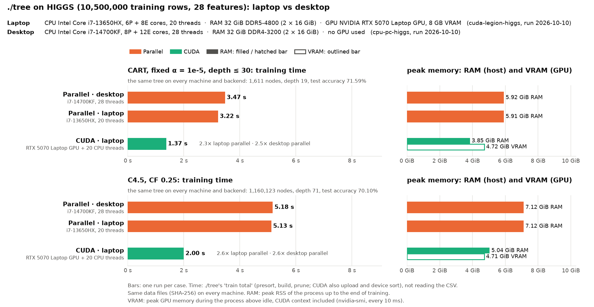

# HIGGS on the desktop and the laptop: ./tree parallel and CUDA

**Status:** run on 2026-10-10 at 19:10 on both machines at the same time, one run per case, commit 49b7f47 (the first runs, at 12:46 on commit abc0a22, are replaced), `performance` governor; the laptop on AC power with platform profile `max-power`. The load averages at the start (desktop 4.1, laptop 2.0) are the SUSY runs that had just ended on each machine (`cuda-legion-susy` on the laptop); nothing else was running. `machine.json` says `-dirty` only because result files were being replaced at the time; the code was committed. The 8 prepared data files have the same SHA-256 on both machines (`meta.json` differs only in the source's column and label names), and every case built the same tree.

| Run | Machine | CPU | RAM | GPU | Backends |
|---|---|---|---|---|---|
| [`cpu-pc-higgs`](cpu-pc-higgs/) | desktop | i7-14700KF, 8P + 12E cores, 28 threads | 32 GiB DDR4-3200 | – | parallel (28 threads) |
| [`cuda-legion-higgs`](cuda-legion-higgs/) | laptop (Legion) | i7-13650HX, 6P + 8E cores, 20 threads | 32 GiB DDR5-4800 | RTX 5070 Laptop GPU, 8 GB | parallel (20 threads), CUDA |

Each subdirectory holds its machine's `run.sh` and results; the chart and this file cover both.

## Run it

```bash
bench/results/pc-legion-higgs/cpu-pc-higgs/run.sh            # on the desktop, each case once
bench/results/pc-legion-higgs/cuda-legion-higgs/run.sh       # on the laptop
bench/results/pc-legion-higgs/cuda-legion-higgs/run.sh -m 5  # each case 5 times
```

- **Time:** a few minutes each, plus preparing HIGGS once (the 7.8 GB CSV into `bench/data/higgs/`).
- **Before:** commit the code, set the `performance` governor (`sudo cpupower frequency-set -g performance`), close browsers and chat apps. On the laptop also AC power, platform profile `max-power`, nothing else on the GPU (as in [`cuda-legion-susy`](../cuda-legion-susy/BENCHMARK.md)).
- **What `run.sh` does:**
  1. Refuses to overwrite existing results.
  2. Builds `./tree_cpu` (and on the laptop `./tree` with CUDA) and prepares HIGGS if it is missing.
  3. Runs the benchmark:
     - desktop: `bench/run.py higgs --protocols cart_alpha,c45 --impls tree --threads all --cpus 2,0,1,3-27 --reps <-m> --timeout 3600`
     - laptop: `bench/run.py higgs --protocols cart_alpha,c45 --impls tree,tree_cuda --threads all --cpus 4,0-3,5-19 --reps <-m> --timeout 3600`
  4. Writes `report.md`, `summary.csv`, `runs.csv` next to `results.jsonl`, `machine.json`, `plan.json` and `run.log`, and redraws `chart.png` here once both runs exist.
- **Chart** (`chart.png`): both machines, the hardware of each in its header, RAM and VRAM as separate bars. It refuses to draw if the data files or trees differ. Alone:
  ```bash
  bench/.venv/bin/python bench/machines_chart.py bench/results/pc-legion-higgs/cpu-pc-higgs \
      bench/results/pc-legion-higgs/cuda-legion-higgs --out bench/results/pc-legion-higgs/chart.png
  ```

## Method

The protocols and measurements of [`cpu-susy-vs-others`](../cpu-susy-vs-others/BENCHMARK.md), ./tree only, on HIGGS:

| Backend | Machine | Command | Threads |
|---|---|---|---|
| Parallel | desktop | `./tree_cpu --parallel --threads 28` | 28 (all logical CPUs of the i7-14700KF) |
| Parallel | laptop | `./tree_cpu --parallel --threads 20` | 20 (all) |
| CUDA | laptop | `./tree --cuda --threads 20` | GPU, plus 20 CPU threads for the small subtrees |

- **No serial run:** the comparison is parallel CPU vs CUDA only.
- **Protocols:** `cart_alpha` (CART, depth ≤ 30, cost-complexity pruning at α = 1e-5) and `c45` (C4.5, CF 0.25, min 2 rows, no depth limit).
- **Data:** HIGGS (Baldi, Sadowski, Whiteson 2014; UCI): 11,000,000 rows, 28 numeric features, 2 classes; the published split, the last 500,000 rows for testing, so 10,500,000 training rows.
- **Same data on both machines:** the two machines have differently formatted copies of `datasets/higgs.csv` (desktop: no `Id` column and labels `0`/`1`; laptop: an `Id` column and labels `background`/`signal`) with the same rows and values. Both labels sort to the same classes (`c0` = background), so the prepared files the tools read must have the same SHA-256 on both machines (`plan.json`); `bench/machines_chart.py` refuses to draw otherwise.
- **GPU memory:** ./tree keeps two copies of all sorted columns on the GPU: 10.5M rows × 28 features × 8 bytes × 2 ≈ 4.4 GiB, plus the CUDA context; the RTX 5070 Laptop GPU has 8 GB. ./tree checks the free memory before allocating and stops with an error if it does not fit.
- **Memory measured:** peak RSS up to the end of training; for CUDA also the peak GPU memory above idle (`nvidia-smi` every 10 ms).

## Results



Training time, one run per case, both machines run fresh:

| | CART | C4.5 |
|---|--:|--:|
| Desktop parallel (i7-14700KF, 28 threads) | 3.47 s | 5.18 s |
| Laptop parallel (i7-13650HX, 20 threads) | 3.22 s | 5.13 s |
| Laptop CUDA (RTX 5070 Laptop + 20 threads) | **1.37 s** | **2.00 s** |

- **Same trees:** CART 1,611 nodes, depth 19, test accuracy 71.59%; C4.5 1,160,123 nodes, depth 71, 70.10%, on both machines, both backends, and the same as in the first runs.
- **CUDA:** 2.3× (CART) and 2.6× (C4.5) faster than the laptop's 20 threads; 2.5× and 2.6× faster than the desktop's 28. About the same gain over the CPU as on SUSY (2.5× and 2.3× over the laptop's 20 threads there).
- **Fits the GPU:** 4.72 GiB of the 8 GB (CART; C4.5 4.71 GiB), CUDA context included. Host peak RSS 3.85 GiB (CART) and 5.04 GiB (C4.5), below the parallel runs.
- **Parallel:** the laptop's 20 threads and the desktop's 28 are within 7% of each other (CART 3.22 vs 3.47 s, C4.5 5.13 vs 5.18 s); repeated runs (below) put the desktop slightly ahead on CART, so one run per case does not tell these two machines apart. Both need the same memory (5.9 GiB CART, 7.1 GiB C4.5): the second copy of the columns for the out-of-place partition dominates, not per-thread buffers.
- **Against the first runs (12:46, commit abc0a22):** CUDA 2.06 → 1.37 s (CART, 1.5×) and 4.08 → 2.00 s (C4.5, 2.0×); laptop parallel 4.60 → 3.22 s and 6.65 → 5.13 s; desktop parallel 4.45 → 3.47 s and 7.29 → 5.18 s. C4.5 used to gain less from CUDA than CART (1.6× against 2.2× over the laptop's 20 threads); its tree of 1.16 million nodes gains from both the GPU changes (the exact pass scores only the cuts the float pass kept) and the CPU ones (./tree --cuda grows the small subtrees and prunes on the CPU, and C4.5 pruning is 2–2.5× faster).

### Why the laptop's 20 threads keep up with the desktop's 28

The desktop's CPU is faster (serial runs on SUSY are 6–9% faster on it), but the parallel build is largely bound by memory bandwidth, and the laptop has the faster RAM.

| Measured on 2026-10-10 | Desktop | Laptop |
|---|--:|--:|
| RAM | DDR4-3200, 2 channels (51.2 GB/s peak) | DDR5-4800, 2 channels (76.8 GB/s peak) |
| STREAM-style triad, all threads | 36 GB/s (28 threads) | 53 GB/s (20 threads) |
| Triad, 1 thread | 28.5 GB/s | 28.9 GB/s |

./tree's own phase timings on HIGGS, `--parallel`, 3 runs each on commit 49b7f47, measured after the benchmark (ms):

| | Presort | Build | Prune | Train total |
|---|--:|--:|--:|--:|
| C4.5 desktop (28 threads) | 730–755 | 3,869–3,900 | 525–582 | 5,154–5,226 |
| C4.5 laptop (20 threads) | 557–563 | 3,897–4,195 | 532–549 | 5,005–5,295 |
| CART desktop (28 threads) | 712–717 | 2,469–2,474 | 9–12 | 3,195–3,198 |
| CART laptop (20 threads) | 495–506 | 2,898–2,936 | 9–12 | 3,408–3,448 |

- **Presort** (sorting every column: streaming through memory) is 1.3–1.4× faster on the laptop in both algorithms, close to the ratio of the measured bandwidth (53 / 36).
- **Build:** CART's takes 15% less time on the desktop (more cores, higher clocks); C4.5's takes about as long on both (the laptop's three runs spread by 8%).
- **Prune** takes ~0.55 s on both (C4.5; it was 1.2–1.4 s before the pruning rework).
- **Net:** C4.5 is a tie (5.15–5.23 s vs 5.01–5.30 s). On CART the desktop's faster build outweighs the laptop's faster presort: 3.20 s vs 3.41–3.45 s, 7% in the desktop's favour, although the single benchmark run above happened to put the laptop ahead.
