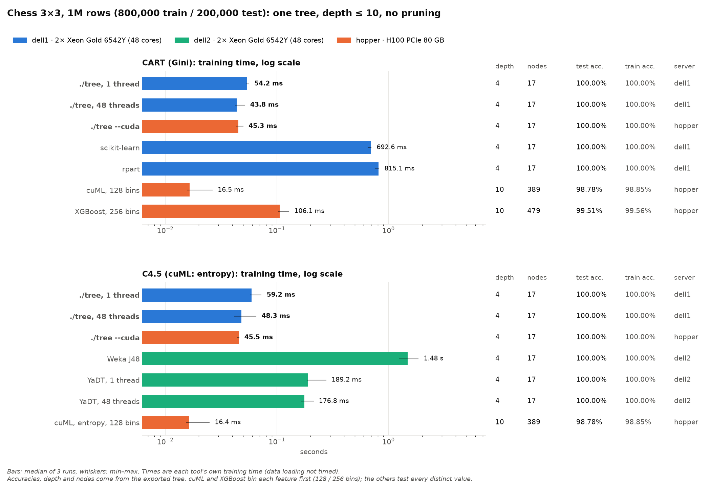

# Tree visualizations: chess 3×3, 1M rows

This benchmark trains one tree per implementation on the chess dataset and draws each tree as an SVG. The dataset is 1,000,000 rows of a 3×3 checkerboard with 2 features (`datasets/chess_1m.csv`). Each SVG also shows the facts of its run, and one chart compares all the training times.

The implementations are ./tree and every other library used in this repository's benchmarks. Every tree is unpruned with depth ≤ 10. The rows are split 80/20: the first 800,000 rows train the tree and the last 200,000 test it.

The runs were on mordor3 on 2026-10-19, with ./tree at 5c2e051 and 3 timed runs per case:

- dell1 ran ./tree on CPU, scikit-learn and rpart.
- dell2 ran Weka J48 and YaDT.
- hopper (H100 PCIe) ran ./tree --cuda and the CUDA-only libraries, cuML and XGBoost.



## The trees

Each SVG shows:

- the training time: the median of 3 runs, with the min–max;
- test and train accuracy;
- depth, nodes and leaves;
- the server, the tool's version and the exact call;
- what the timer covers;
- a check that the drawn tree predicts the test rows exactly as the library itself does;
- a small map of the tree's decision regions over the true 3×3 board.

Trees with up to 64 leaves are drawn with full node boxes, including the threshold, the row count and a class-mix bar. Larger trees are drawn compactly. Hovering over any node shows its numbers.

| Case | Implementation | Server | Training time (median) | Depth | Nodes | Test accuracy | SVG |
|---|---|---|---:|---:|---:|---:|---|
| CART | ./tree, 1 thread | dell1 | 54.2 ms | 4 | 17 | 100.00% | [tree-serial-cart](svg/tree-serial-cart.svg) |
| CART | ./tree, 48 threads | dell1 | 43.8 ms | 4 | 17 | 100.00% | [tree-parallel-cart](svg/tree-parallel-cart.svg) |
| CART | ./tree --cuda | hopper | 45.3 ms | 4 | 17 | 100.00% | [tree-cuda-cart](svg/tree-cuda-cart.svg) |
| CART | scikit-learn 1.9.1 | dell1 | 692.6 ms | 4 | 17 | 100.00% | [sklearn-cart](svg/sklearn-cart.svg) |
| CART | rpart 4.1.27 | dell1 | 815.1 ms | 4 | 17 | 100.00% | [rpart-cart](svg/rpart-cart.svg) |
| CART | cuML 26.10, Gini, 128 bins | hopper | 16.5 ms | 10 | 389 | 98.78% | [cuml-cart](svg/cuml-cart.svg) |
| CART | XGBoost 3.4.1, 256 bins | hopper | 106.1 ms | 10 | 479 | 99.51% | [xgboost-cart](svg/xgboost-cart.svg) |
| C4.5 | ./tree, 1 thread | dell1 | 59.2 ms | 4 | 17 | 100.00% | [tree-serial-c45](svg/tree-serial-c45.svg) |
| C4.5 | ./tree, 48 threads | dell1 | 48.3 ms | 4 | 17 | 100.00% | [tree-parallel-c45](svg/tree-parallel-c45.svg) |
| C4.5 | ./tree --cuda | hopper | 45.5 ms | 4 | 17 | 100.00% | [tree-cuda-c45](svg/tree-cuda-c45.svg) |
| C4.5 | Weka J48 (Weka 3.8.8) | dell2 | 1.48 s | 4 | 17 | 100.00% | [j48-c45](svg/j48-c45.svg) |
| C4.5 | YaDT 2.3.0, 1 thread | dell2 | 189.2 ms | 4 | 17 | 100.00% | [yadt-1t-c45](svg/yadt-1t-c45.svg) |
| C4.5 | YaDT 2.3.0, 48 threads | dell2 | 176.8 ms | 4 | 17 | 100.00% | [yadt-48t-c45](svg/yadt-48t-c45.svg) |
| C4.5 | cuML 26.10, entropy, 128 bins | hopper | 16.4 ms | 10 | 389 | 98.78% | [cuml-c45](svg/cuml-c45.svg) |

`summary.csv` has every row with min/max, train accuracy, version and command. `results/*.json` has each exported tree with its metadata.

**What it shows:**

- **Exact trees.** Every implementation that tests every distinct value finds the same 17-node tree: 8 splits at x, y ≈ 1 and 2, and 9 pure leaves. This holds for ./tree, scikit-learn, rpart, J48 and YaDT. The thresholds differ only in where between the two neighboring values they fall.
- **Binned trees.** cuML and XGBoost first bin each feature into quantiles, and no bin edge falls exactly on 1 or 2. They therefore fill all 10 levels with slivers along the board's lines and still misclassify 0.5–1.2% of the test rows.
- **cuML's two cases.** cuML grows the same tree for Gini and entropy.
- **Speed.** cuML is the fastest at 16 ms, about 3× ./tree. At 1M rows ./tree's times are mostly fixed costs: the CUDA setup on hopper, and thread start-up and presort on the CPU. The 1000M-row comparison in [cluster-tree-vs-gpu-libs](../cluster-tree-vs-gpu-libs/BENCHMARK.md) shows the opposite ordering. Against the CPU libraries ./tree is 13–19× faster than scikit-learn and rpart, 3–4× faster than YaDT and 25–31× faster than J48.

## Method

**Timing.** Each tool's own training time is measured, not data loading, as the median of 3 runs. ./tree and YaDT start a fresh process for every run. The libraries that train inside a process (scikit-learn, rpart, J48, cuML, XGBoost) first do one untimed warm-up fit on 50,000 rows.

- **./tree:** `train total` (presort and build) from a fresh process per run. On CUDA this also includes GPU setup and upload, which is most of its 45 ms.
- **scikit-learn, rpart and J48:** wall-clock time of the fit call within one process.
- **YaDT:** its total time minus its loading time.
- **cuML and XGBoost:** the fit from host float32 arrays, so copying to the GPU and binning are included.

**Settings.**

- Depth ≤ 10 for every implementation, no pruning, and minimum leaf sizes at their smallest.
- CART uses Gini. XGBoost uses `reg:squarederror` with `lambda=0` and `eta=1` for one round, whose gain equals Gini's on 0/1 labels. Its leaf predicts B when base_score + leaf value > 0.5.
- C4.5 uses gain ratio. cuML has no gain ratio, so its C4.5 case uses entropy.
- J48 has no depth limit, so its tree is cut at depth 10 after training. It was 4 levels deep, so nothing was cut.

**Machines and placement.**

- dell1 and dell2 each have 2× Xeon Gold 6542Y with 48 cores. Every job held its whole node with `--exclusive`.
- The single-threaded libraries ran two at a time, pinned to one core on each socket:
  - scikit-learn on CPU 0 with rpart on CPU 24, on dell1;
  - J48 with YaDT 1-thread, on dell2.
- ./tree's 48-thread runs and YaDT's 48-thread run each ran alone.
- On hopper, everything ran on GPU 0. ./tree used `--cuda --threads 32`.

**Export check.** Each library's tree is exported into one common JSON format (nested splits and leaves; `scripts/treeio.py`) and read without rounding:

| Library | Read from |
|---|---|
| scikit-learn | `tree_` |
| rpart | `frame`/`splits` |
| J48 | its `ClassifierTree`, by reflection (its text output rounds the thresholds) |
| YaDT | its XML tree |
| cuML | its treelite model |
| XGBoost | its raw float32 model (the text dump rounds the leaf values) |
| ./tree | `--dump` |

Accuracy, depth and node count are then computed by walking that tree. Each library's own test predictions match the walk on all 200,000 rows (`test_export_mismatches` is 0). For ./tree, the walk's train accuracy matches the train accuracy ./tree prints.

## Running it

From the repository root on mordor3's login node:

```bash
bench/results/visualization/run.sh
```

This submits 5 SLURM jobs:

1. `prepare` on dell1 writes the split to `bench/data/chess_1m_8020`.
2. `dell1`, `dell2` and `hopper` start after it, at the same time.
3. `render` on dell1 starts when all three have finished. It writes `svg/`, `chart.png`, `chart.svg` and `summary.csv`.

Logs go to `logs/<role>.log`. `REPS=5 bench/results/visualization/run.sh` changes the number of timed runs.

**Requirements:**

| What | Where |
|---|---|
| CPU Python | `bench/.venv` |
| R and Java | `~/micromamba/envs/dtbench` |
| `weka.jar` and YaDT | `bench/.tools` |
| cuML and XGBoost | `~/gpu-dt-bench/venv` (`GPU_PY`) |

The SVGs can be redrawn from `results/` on any machine with Python 3 and numpy:

```bash
python3 scripts/render.py results/*.json --out svg
```

`scripts/fit.py` trains one implementation and writes its JSON. `render.py` and `chart.py` only read those files.
