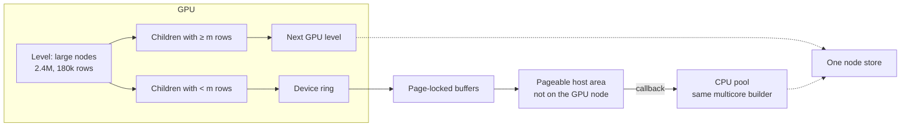

# Diagram proposal — one level of Hybrid

## (a) Why this figure

Include it. The contribution is that one tree is split by node size, with the CPU growing small subtrees while the GPU continues. Related work already states that in prose. At a two-page text budget, a single level picture carries the concurrency and the copy path that the Hybrid subsection would otherwise have to spell out. A second figure (column layout, kernel pipeline, or a NUMA map) does not earn its space.

The draft already points at it: `draft-grok.tex` uses `\includegraphics{figs/approach-hybrid.pdf}` and `\label{fig:hybrid}`.

## (b) What it must show

One horizontal scene, left to right, of a single level of `\ImplHybrid`:

1. **GPU, this level.** Two or three large nodes still on the device (label them by row count, e.g. 2.4M and 180k). They share one launch sequence, not one box per kernel.
2. **The size test, on the children.** After the split, children at or above \(m\) stay on the GPU and become the next level. Children below \(m\) leave.
3. **The copy, three hops.** Device ring → page-locked host buffers → pageable host area. One arrow is enough if the three names are on the arrow. Do not draw the upload staging buffers of Section 3.5; those are a different path.
4. **CPU pool, concurrent.** The host area feeds the same multicore builder. Show it busy while the GPU’s next level has already started. A callback label on the arrow into the pool is enough (“host callback starts tasks”).
5. **One tree.** A thin bracket or a shared “node store” under both devices, so the picture is one tree with two writers, not two models.

`\ImplGpu` is a caption clause, not a second panel: those small children would have stayed on the device.

## (c) What to omit

- Kernel names, tiles, warps, histograms, and the double-precision filter.
- Presort, the 8-byte entry layout, and spare column slots.
- Any NUMA or socket drawing. The only placed objects are the small staging buffers, and the host area is **not** on the GPU’s node. A socket picture would overclaim.
- The numeric default for \(m\) (\(N/8192\), and so on). The text owns the formula. The figure says only “fewer than \(m\) rows”.
- Pruning, the ring’s 512 MB, and PCIe bandwidth.
- Depth-first CPU detail inside the pool. One box, “Multicore CPU builder”, is enough.

## (d) Caption draft

This is the caption already in `draft-grok.tex`. Keep them identical.

> One level of Hybrid. Large nodes stay on the GPU. Children below the size threshold are copied to the host, and the CPU pool grows them while the GPU starts the next level. GPU-Based keeps those children on the device.

In the paper, Hybrid and GPU-Based are `\ImplHybrid{}` and `\ImplGpu{}`.

## (e) Sketch



Reading order: the GPU splits the level; large children form the next GPU level immediately; small children travel ring → pinned buffers → host area; the callback starts CPU tasks; both sides append to one store. The dashed arrows into the store are concurrent, not a barrier.

TikZ equivalent, one row of boxes, if mermaid is redrawn by hand:

```latex
% paper/figs/approach-hybrid.tex  (standalone or included)
% Boxes, left to right:
%   [GPU level: large nodes] --split--> [children >= m] --> [next GPU level]
%                              \-- < m --> [device ring] --> [pinned buffers]
%                                  --> [pageable host area] --callback--> [CPU pool]
%   Both [next GPU level] and [CPU pool] point down to [shared node store].
% Do not draw a NUMA node around the host area.
```
