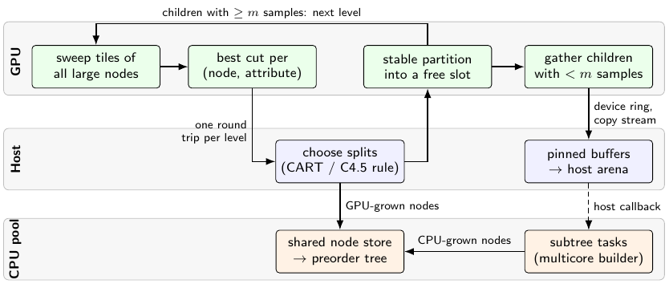

# Section 3 diagram proposal (Opus)

**Decision: include one figure, "One level of \ImplHybrid{}"** (`figs/approach-hybrid.pdf`).

A working TikZ sketch is next to this file:

* source: `approach-hybrid-sketch.tex` (standalone; `tikz`, `arrows.meta`,
  `positioning`, `fit`, `backgrounds`);
* preview: `approach-hybrid-sketch.png`.

It compiles with `pdflatex` to a 400 × 170 pt PDF, which is scaled to
`\textwidth` (about 347 pt in LNCS). It costs about 0.3 page with the
caption.



---

## (a) Why this figure

* **The hybrid is the paper's main contribution.** The Introduction and
  Related Work both build up to it ("individual nodes of one tree, both
  devices at the same time"). Its prose in §3.6 is the densest part of the
  section: ring, pinned buffers, arena, host callback, shared store. A
  diagram makes the concurrency visible: the GPU loop never waits on the
  CPU lane.
* **One figure also covers §3.5.** The GPU lane is the level loop of
  \ImplGpu{}. The caption states that \ImplGpu{} is the same scheme with
  \(m=1\). Section 3 therefore needs no second figure.
* **Alternatives considered and rejected:**
  * A column/slot layout diagram (a node range across presorted columns).
    It is useful but textbook (SLIQ/SPRINT), and §3.3 explains it in two
    sentences.
  * A kernel pipeline. That is too low-level and invites the
    kernel-by-kernel walkthrough the plan excludes.
  * A Gantt-style timeline. It would need measured data, which belongs in
    Results (the profile chart).

## (b) What it must show

1. **Three lanes:** GPU, Host (the thread running the level loop and host
   memory), and CPU pool.
2. **GPU level loop:**
   * sweep the tiles of *all* large nodes;
   * best cut per (node, attribute);
   * **one round trip** to the host, which applies the CART/C4.5 rule;
   * stable partition;
   * loop back with the children that have \(\ge m\) samples.
3. **Hand-off branch:**
   * gather the children with \(< m\) samples;
   * device ring and copy stream;
   * pinned buffers into the host arena;
   * a *dashed* host-callback arrow to the subtree tasks, marking control
     rather than data.
4. **One tree:** both lanes feed a shared node store, followed by the
   preorder tree, which is why the result is identical.
5. **Size threshold \(m\)** written on both branches (\(\ge m\) stays,
   \(< m\) leaves).

## (c) What to omit

* Kernel names, tile size, the 512 MB ring, the 128 MB or 32 MB buffer
  sizes, and the number of streams. They clutter the figure and belong in
  the text or the repository.
* The upload/presort phase and the NUMA placement of staging buffers.
  This is setup, not the level loop. It is described in §3.5 text, and
  putting it in the figure could suggest the arena is NUMA-placed.
* The class-histogram side output of the partition, the constant-segment
  skip, and the two-pass float filter.
* Any timing, bar or proportion. The boxes must not be sized by duration.
* C4.5 pruning and leaf-id merging.
* The CPU pool's internal attribute/subtree parallelism. Write "multicore
  builder" and point to §3.4.

## (d) Caption draft

> **Fig. N.** One level of \ImplHybrid{}. The GPU sweeps and partitions all
> large nodes of the level together; the host chooses each node's split.
> Children with fewer than \(m\) samples are gathered into a device ring
> buffer, copied through pinned buffers into a host arena, and grown as
> subtree tasks by the CPU threads while the GPU continues with the next
> level. \ImplGpu{} is the same scheme without the hand-off (\(m=1\)).

(About 65 words. It is already in `draft-opus.tex`.)

## (e) Sketch

The TikZ code is in `approach-hybrid-sketch.tex`. The structure as boxes
and arrows:

```
 GPU   [sweep tiles of all large nodes] → [best cut per (node, attr)]      [stable partition] → [gather children < m]
         ↑_________________ children ≥ m: next level _______________________________|                 |
                                         |  one round trip per level           ↑                       | device ring,
 Host                                    └→ [choose splits (CART/C4.5 rule)] ──┘          [pinned buffers → host arena]
                                                    | GPU-grown nodes                                 ┆ host callback (dashed)
 CPU pool                                   [shared node store → preorder tree] ←CPU-grown nodes── [subtree tasks (multicore builder)]
```

Colours: GPU green!8, host blue!6, CPU orange!10. All three are light
enough to print in greyscale. Use sans-serif footnotesize labels.

### Points for reviewers to improve

* **Paper integration.** `main.tex` does not load TikZ. Either compile the
  standalone file to `figs/approach-hybrid.pdf` (recommended; keeps the
  preamble unchanged) or add `\usepackage{tikz}` and `\input` it.
* **Label overflow.** The rotated label "CPU pool" slightly exceeds its
  lane height. Shorten it to "CPU" with "pool" in the caption, or raise
  the lane height by 1 mm.
* **The Host vs CPU pool split.** It is conceptual: both run on the same
  CPUs. The host lane is the level-loop thread plus host memory; the pool
  lane holds the worker threads. The caption could say so if a reviewer
  finds it confusing.
* **Width.** The natural width is 400 pt, shrunk to about 87% at
  `\textwidth`. If the labels become too small, cut the box widths
  (`minimum width=24mm`) instead of the font.
* **Optional, to emphasize concurrency:** a faint second copy of the GPU
  lane marked "level \(d+1\)" overlapping the CPU-task arrow. Add it only if
  it stays uncluttered.
